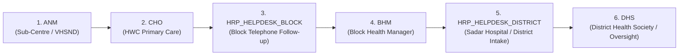

# Matru Suraksha

[](https://github.com/adityapandey2002/MATERNAL_HEALTH_HRP/actions/workflows/ci.yml)
[](https://www.typescriptlang.org/)
[](https://fastify.dev/)
[](https://react.dev/)
[](https://www.postgresql.org/)
[](LICENSE)

> **Multi-tier High-Risk Pregnancy (HRP) Identification, Clinical Tracking, and Closed-Loop Follow-Up Platform for India's Public Healthcare Ecosystem.**

Piloted in **Araria District, Bihar**, Matru Suraksha connects frontline community health workers, primary facility clinicians, block helpdesks, and district hospital specialists into a unified continuum of maternal care.

---

## Table of Contents

- [Overview & Public Health Context](#overview--public-health-context)
- [The Six User Roles](#the-six-user-roles)
- [Core Architectural Pillars](#core-architectural-pillars)
- [Live Pilot Demo](#live-pilot-demo)
- [Technical Documentation](#technical-documentation)
- [Technology Stack](#technology-stack)
- [Quick Start Guide](#quick-start-guide)
  - [Option A: Docker Compose (Full Stack)](#option-a-docker-compose-full-stack)
  - [Option B: Local Host Development](#option-b-local-host-development)
  - [Verification & Smoke Tests](#verification--smoke-tests)
- [Default Test Credentials](#default-test-credentials)
- [Repository Structure](#repository-structure)
- [Quality Gates & Floor Red Lines](#quality-gates--floor-red-lines)
- [Deployment Options](#deployment-options)
- [Roadmap & Integrations](#roadmap--integrations)
- [License](#license)

---

## Overview & Public Health Context

In rural India, high-risk pregnancies contribute disproportionately to maternal and neonatal mortality. Frontline workers identify clinical danger signs (severe anemia, hypertension, gestational diabetes), yet mothers frequently miss specialized interventions due to fragmented communications, lack of follow-up accountability, and rural connectivity blackouts.

**Matru Suraksha** resolves this breakdown through:
1. **7-Field Frontline Intake:** Rapid community registration during village outreach (VHSND) and Sub-Centre visits.
2. **Automated Clinical Risk Engine:** Instant identification of high-risk conditions using evidence-based clinical rules.
3. **Closed-Loop 15-Day Follow-Up:** A repeating 15-day cycle where referred cases begin under active telephone tracking by the block helpdesk, before returning to frontline workers for community home monitoring.
4. **Offline-First Resilience:** Client-side IndexedDB caching and AES-256-GCM field encryption enabling uninterrupted clinical operations without cellular data.

---

## The Six User Roles

The platform enforces a strict 6-tier administrative and clinical role hierarchy:

```
ANM ──> CHO ──> HRP_HELPDESK_BLOCK ──> BHM ──> HRP_HELPDESK_DISTRICT ──> DHS
```



- **`ANM` (Auxiliary Nurse Midwife):** Frontline tablet user conducting community registration, danger sign screening, and routine ANC checks.
- **`CHO` (Community Health Officer):** Clinician at Ayushman Bharat Health & Wellness Centres (HWC-SC) diagnosing high-risk complications and initiating hospital referrals.
- **`HRP_HELPDESK_BLOCK` (Block Helpdesk Operator):** BPHC/CHC operator conducting telephone outreach to confirm hospital attendance within 15 days.
- **`BHM` (Block Health Manager):** Administrative block lead overseeing staff provisioning and escalating overdue clinical tasks.
- **`HRP_HELPDESK_DISTRICT` (District Helpdesk Operator):** Operates at Sadar Hospital managing complex referral intake and ultrasound/specialist appointments.
- **`DHS` (District Health Society / Civil Surgeon):** Strategic district executive monitoring clinical indicators across all blocks.

---

## Core Architectural Pillars

- **Offline-First Frontline Storage:** Encrypted IndexedDB (`Dexie.js`) on Android tablets caches the active facility cohort. Clinical data entry never blocks on poor 2G/3G connectivity.
- **Client Field-Level Cryptography:** Direct clinical identifiers are encrypted locally via AES-256-GCM. The Device Encryption Key (DEK) is derived via PBKDF2 (600,000 iterations) from a 6-digit user PIN and held solely in volatile memory. A 10-attempt lockout auto-wipes local data to protect lost devices.
- **Dual-Transport Authentication:** Web browser clients use `httpOnly`, `SameSite=Lax`, `Secure` cookies for XSS mitigation. Native Android APK clients utilize `Authorization: Bearer <token>` headers.
- **Hierarchical ABAC Jurisdiction:** Every user and facility possesses a dot-separated materialized path (`INDIA.BIHAR.ARARIA.RANIGANJ.HSC_SIKTI`). Access queries enforce jurisdiction via SQL `LIKE` prefix matching.

---

## Live Pilot Demo

- **URL:** [https://hrp-demo.onrender.com](https://hrp-demo.onrender.com)
- **Environment:** Hosted on Render web service backed by Neon PostgreSQL.
- **Data Notice:** Contains **synthetic demonstration data only**. Do not enter real patient health information.
- **Demo Accounts:** Default password `password123` across all roles (see [Default Test Credentials](#default-test-credentials)).

---

## Technical Documentation

Matru Suraksha maintains complete, production-grade technical documentation in the [`docs/`](docs/) directory:

| Section | Link | Key Topics |
| :--- | :--- | :--- |
| **System Overview** | [`01-project-overview.md`](docs/01-project-overview.md) | Problem context, Bihar pilot scope, 6 roles, core capabilities. |
| **Tech Stack** | [`02-technology-stack.md`](docs/02-technology-stack.md) | Package inventory, exact versions, runtime environments. |
| **Directory Tree** | [`03-project-structure.md`](docs/03-project-structure.md) | Root layout, workspaces, backend, frontend, scripts. |
| **System Architecture**| [`04-system-architecture.md`](docs/04-system-architecture.md) | Layered design, offline sync engine, import boundaries. |
| **Workflows** | [`05-application-workflows.md`](docs/05-application-workflows.md) | Auth lifecycle, 7-field intake, 15-day follow-up cycle. |
| **Modules & Features** | [`06-modules-and-features.md`](docs/06-modules-and-features.md) | Shared rules, server services, client view components. |
| **Database** | [`07-database-documentation.md`](docs/07-database-documentation.md) | PostgreSQL 16 schema, 13 tables, migrations 001–009. |
| **REST API** | [`08-api-documentation.md`](docs/08-api-documentation.md) | Complete endpoint schemas, payloads, status codes. |
| **Auth & Security** | [`09-authentication-and-authorization.md`](docs/09-authentication-and-authorization.md) | JWT tokens, 24 actions policy, ABAC materialized paths. |
| **Configuration** | [`10-configuration-and-environment.md`](docs/10-configuration-and-environment.md) | Environment variables, Zod validation, profile matrices. |
| **Setup & Install** | [`11-installation-and-setup.md`](docs/11-installation-and-setup.md) | Step-by-step developer setup, Docker, Capacitor build. |
| **Development** | [`12-development-guide.md`](docs/12-development-guide.md) | Monorepo commands, floor red lines, migration creation. |
| **Testing & QA** | [`13-testing-and-quality.md`](docs/13-testing-and-quality.md) | Vitest, Testcontainers, Playwright, $\ge 80\%$ coverage bar. |
| **Infrastructure** | [`14-deployment-and-infrastructure.md`](docs/14-deployment-and-infrastructure.md) | Render blueprint, Docker Compose, Android CI artifact pipeline. |
| **Security Controls** | [`15-security-documentation.md`](docs/15-security-documentation.md) | Threat model, AES-256-GCM, PBKDF2 PIN vault, scanners. |
| **Errors & Logging** | [`16-error-handling-and-logging.md`](docs/16-error-handling-and-logging.md) | Fastify error hooks, Pino JSON logs, retry backoff. |
| **Integrations** | [`17-integrations-and-third-party-services.md`](docs/17-integrations-and-third-party-services.md) | Capacitor Android, ABDM (M1-M3), FHIR R4, eSanjeevani. |
| **Troubleshooting** | [`18-maintenance-and-troubleshooting.md`](docs/18-maintenance-and-troubleshooting.md) | Advisory lock 727001 runbook, sync conflicts, PIN resets. |
| **Performance** | [`19-performance-and-scalability.md`](docs/19-performance-and-scalability.md) | Fastify benchmarks, LCP/CLS budgets, index tuning. |
| **Roadmap** | [`20-future-improvements.md`](docs/20-future-improvements.md) | Production APK, hardware biometrics, IVR voice calls. |
| **AI Agent Guide** | [`AI_AGENT_CONTEXT.md`](docs/AI_AGENT_CONTEXT.md) | Operational prompt reference for AI coding assistants. |

### Visual Architectural Diagrams

- [System Architecture Models](docs/diagrams/system-architecture.md) — Layered tiers and offline sync flows.
- [Application Flow Diagrams](docs/diagrams/application-flow.md) — Auth, intake, 15-day cycle state machines.
- [Database ER Diagram](docs/diagrams/database-er-diagram.md) — Complete 13-table visual entity-relationship diagram.
- [Deployment Topologies](docs/diagrams/deployment-architecture.md) — Local, pilot, and sovereign State Data Centre setups.

---

## Technology Stack

```
packages/
  shared/   --> Pure business logic, Zod schemas, TypeScript types, date utilities
  server/   --> Fastify 4, Kysely, PostgreSQL 16, JWT auth, migrations
  client/   --> React 18, Vite 5, Tailwind CSS, TanStack Query, Dexie, Capacitor 6
```

- **Frontend Tier:** React 18, TypeScript, Vite, Tailwind CSS, TanStack Query 5, Dexie 4 (IndexedDB), Lucide Icons, Workbox PWA.
- **Native Mobile Shell:** Capacitor 6 (@capacitor/android, @capacitor/cli) for Android tablets.
- **Backend Tier:** Node.js 20+, Fastify 4, `@fastify/jwt`, `@fastify/cookie`, `@fastify/helmet`, `@fastify/rate-limit`, Pino.
- **Data Access & Storage:** PostgreSQL 16, Kysely TypeScript query builder.
- **Tooling & CI:** Biome (linter/formatter), Vitest (unit/integration), Playwright (E2E), Semgrep (SAST), OSV-Scanner (CVEs).

---

## Quick Start Guide

### Option A: Docker Compose (Full Stack)

Run the entire platform (database, API server, and web client) via Docker:

```bash
# 1. Start all container services
docker compose up -d

# 2. Run database migrations and seed demonstration data
npm run db:migrate
npm run db:seed

# 3. Access web application in your browser
# Client PWA: http://localhost:5173
# Server API: http://localhost:3000
# Health Check: http://localhost:3000/health
```

### Option B: Local Host Development

Run frontend and backend dev servers on the local machine with hot module reloading:

```bash
# 1. Install workspace dependencies
npm install

# 2. Start PostgreSQL container
npm run db:up

# 3. Apply migrations and seed demonstration records
npm run db:migrate
npm run db:seed

# 4. Start concurrent development servers
npm run dev

# Or start services in separate terminals:
npm run dev:client   # Starts Vite dev server at http://localhost:5173
npm run dev:server   # Starts Fastify API server at http://localhost:3000
```

### Verification & Smoke Tests

Verify system health and end-to-end API communication:

```bash
# Exercise core API flows against server
npm run test:smoke

# Verify API requests through Vite client reverse proxy
npm run test:smoke:proxy
```

---

## Default Test Credentials

All test accounts are seeded with the password `password123`:

| Role | Username / Email | Access Level | Jurisdiction Scope |
| :--- | :--- | :--- | :--- |
| **ANM** | `ANM001` | Frontline Intake & ANC | HSC Sikti Sub-Centre |
| **CHO** | `CHO001` | Clinical Exam & Referrals | HWC Sikti Primary Health Centre |
| **HRP Helpdesk (Block)** | `helpdesk.daskroi@araria.gov.in` | 15-Day Telephone Outreach | Raniganj Block Facilities |
| **BHM** | `MO001` | Block Administrative Lead | Raniganj Block Hierarchy |
| **HRP Helpdesk (District)**| `helpdesk.district@araria.gov.in` | District Referral Triage | Sadar Hospital & District Araria |
| **DHS** | `ADM001` | Executive Oversight & Admin | Entire Araria District |

---

## Repository Structure

```
hrp/
├── packages/
│   ├── shared/                   # Domain schemas, pure risk engine, date utilities
│   ├── client/                   # React 18 PWA & Capacitor Android frontend
│   └── server/                   # Fastify 4 API server & Kysely database layer
├── docs/                         # Comprehensive 20-chapter technical documentation
│   ├── diagrams/                 # Visual Mermaid system & database architecture models
│   ├── runbooks/                 # Operational runbooks (deployments, backups)
│   └── specs/                    # Role matrices and 15-day follow-up specifications
├── scripts/                      # Automated quality gates, secret scanners, smoke tests
├── android/                      # Native Capacitor Android shell project
├── docker-compose.yml            # Local development compose file
├── docker-compose.preview.yml    # Same-origin preview container configuration
├── docker-compose.prod.yml       # Production registry-image deployment configuration
├── CONSTRAINTS.md                # Quality gate thresholds and floor constraints
└── AGENTS.md                     # Coding rules for human developers and AI agents
```

---

## Quality Gates & Floor Red Lines

Matru Suraksha enforces automated quality gates in local workflows and GitHub Actions:

```bash
# 1. Fast Check (types, Biome linting, secret scanning, retired identifiers)
npm run check:fast

# 2. Task Completion (Fast check + unit tests + changed-line coverage >= 80%)
npm run check:task

# 3. Full PR Gate (All tests + Semgrep SAST + OSV supply chain vulnerability scan)
npm run check:full

# 4. Production Budgets (Performance, accessibility, and bundle size)
npm run check:perf && npm run check:a11y && npm run check:bundle
```

### The Quality Floor (Zero Tolerance)
Never introduce:
- `@ts-ignore`, `eslint-disable`, or `biome-ignore` suppression comments.
- `throw new Error("Not implemented")` or empty `catch {}` blocks.
- Unjustified test removals or assertions deletions.
- Secrets, passwords, or access tokens in source code.
- Retired schema or role identifiers (enforced via `scripts/check-retired-identifiers.mjs`).

---

## Deployment Options

1. **Live Demo Deployment (Render + Neon):** Single-origin web service configured via `render.yaml` serving both API and static assets with synthetic demonstration data.
2. **Preview Stack:** Local containerized build evaluating production container artifacts (`docker-compose.preview.yml`).
3. **Production Enterprise Stack:** High-availability configuration consuming pre-built registry images with separate migration initialization jobs (`docker-compose.prod.yml`).
4. **Android APK Pipeline:** Built automatically via GitHub Actions using Capacitor and Gradle, uploaded as CI build artifacts for tablet MDM installation.

---

## Roadmap & Integrations

- [x] Frontline 7-field high-risk intake and danger sign screening.
- [x] Automated evidence-based clinical risk rules (anemia, preeclampsia, diabetes).
- [x] Repeating 15-day follow-up loop with block-owned initial contact.
- [x] Automatic DHS district escalation for overdue follow-up tasks.
- [x] Offline client caching with Dexie IndexedDB.
- [x] Client field-level AES-256-GCM encryption with 6-digit PBKDF2 PIN vault.
- [x] Dual-transport JWT authentication with refresh token rotation.
- [x] Capacitor 6 Android native tablet shell.
- [ ] Production Android APK signing & State Mobile Device Management (MDM) integration.
- [ ] Ayushman Bharat Digital Mission (ABDM) Milestone 1–3 compliance.
- [ ] HL7 FHIR Release 4 clinical resource export.
- [ ] eSanjeevani teleconsultation integration for Community Health Officers.
- [ ] Automated vernacular IVR voice reminders for scheduled hospital referrals.

---

## License

Government of India / National Health Mission (NHM) Public Health Project.
All rights reserved.
