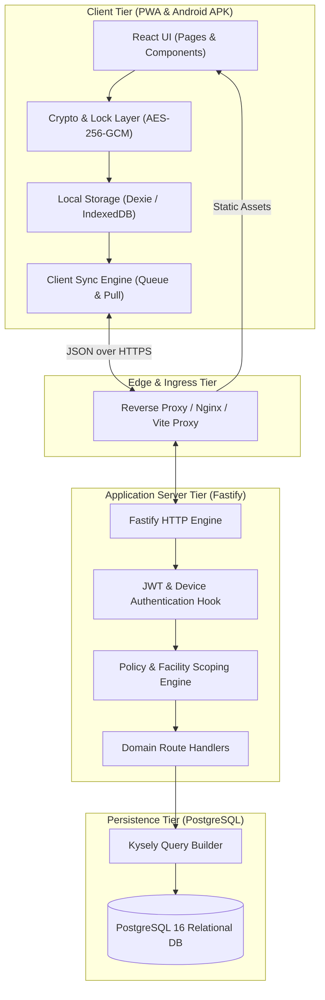
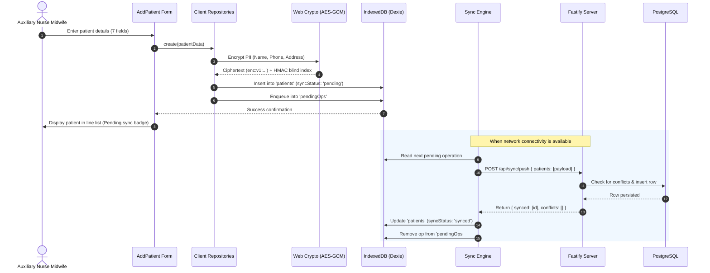
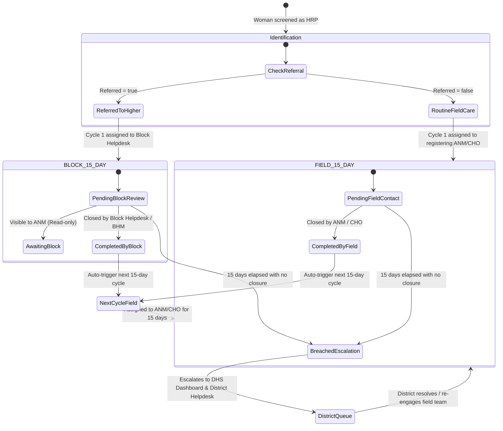

# Matru Suraksha — System Architecture

This document describes the end-to-end software architecture of **Matru Suraksha**, detailing its multi-tier system topology, data-flow boundaries, offline synchronization mechanisms, and security perimeters.

---

## 1. High-Level Architectural Pattern

Matru Suraksha implements an **Offline-First Layered Architecture** with strict hierarchical multi-tenancy based on public health administrative structures:

### Core Design Principles:
1. **Unidirectional Dependency Flow:** `packages/client` and `packages/server` depend on `@hrp/shared`. Client code never imports server code, and server code never imports client code.
2. **Local-First Write Invariant:** Clinical data entry (patient registration, visits, follow-up closures) on field devices always writes to local IndexedDB first, then enqueues an asynchronous mutation operation. The UI never blocks on cellular connectivity.
3. **Deterministic SQL Construction:** Server queries are constructed with Kysely, producing explicit, parameterized SQL queries that enforce facility-scoping predicates on every database read and write.
4. **Hierarchical Scoping (ABAC):** Access control evaluates the actor's role combined with their facility's position in the administrative tree (`path`), preventing unauthorized cross-block or cross-district data leakage.

---

## 2. Multi-Tier Application Layers

### 2.1 The Client Presentation Layer (`packages/client`)
- **Single Page Application (SPA):** Built with React 18, React Router v6, and TanStack Query.
- **Role-Adaptive Interface:** `packages/client/src/lib/nav.ts` evaluates the active user's role to render the appropriate operational shell:
  - `ANM` / `CHO`: Field-first view with big "Add case" primary action, offline indicators, and 15-day follow-up cards.
  - `BHM` / `HRP_HELPDESK_BLOCK`: Block surveillance dashboard, triage line-list, dispatch box, and staff provisioning.
  - `DHS` / `HRP_HELPDESK_DISTRICT`: District KPI summaries, breached follow-up escalation queue, and block-level drilldowns.
- **PWA Service Worker:** Powered by Workbox via `vite-plugin-pwa`. It precaches the application shell (HTML, JavaScript, CSS, fonts, SVG icons) to allow instant cold-starts in offline environments.

### 2.2 Client Offline Data & Cryptographic Layer
- **Dexie.js Persistence:** Operates an IndexedDB instance (`hrp-matru-suraksha`) holding six local tables: `patients`, `visits`, `followUps`, `pendingOps`, `conflicts`, and `meta`.
- **Zero-Trust Field Encryption:**
  - Direct identifiers (`name`, `phone`, `address`, `ashaName`, `ashaPhone`) and clinical notes are encrypted using AES-256-GCM prior to Dexie writes (`packages/client/src/lib/crypto.ts`).
  - The Data Encryption Key (DEK) is generated randomly on initial PIN setup and wrapped by a Key Encryption Key (KEK) derived from a 6-digit PIN using PBKDF2 (600,000 iterations of SHA-256).
  - The DEK exists strictly in JavaScript memory. When the application backgrounding timer expires (3 minutes) or the device is locked, the key is purged.
  - Exact-name matching is supported without decryption using an HMAC-SHA-256 blind index derived via HKDF from the master key.

### 2.3 Client Synchronization Engine (`packages/client/src/lib/sync/`)
- **Queue Engine (`queue.ts`):** Serializes create/update mutations into `pendingOps`.
- **Drain Coordinator (`engine.ts`):** Automatically triggers synchronization when:
  1. The application boots or resumes from background.
  2. The browser `online` event fires.
  3. A local mutation is enqueued.
  4. The user clicks "Sync Now" in Settings.
- **Conflict Handling:** Server version timestamps take precedence (`updated_at > clientUpdatedAt`). Conflicting records are preserved locally in the `conflicts` table for manual review, ensuring no data is silently discarded.

### 2.4 Server & Ingress Layer (`packages/server`)
- **Fastify Framework:** Configured with custom JSON parsers, CORS handlers, security headers (CSP, HSTS, X-Content-Type-Options), and cookie parsers.
- **Static Asset Serving:** In production and preview modes, the Fastify server directly serves the compiled client distribution (`packages/client/dist`) with index.html fallback for client-side routing.
- **Same-Origin Proxy:** In development and Docker setups, browser API calls route through `/api`, eliminating cross-origin cookie restrictions and ensuring `SameSite=Lax` refresh cookies function reliably.

### 2.5 Security, Authentication & Authorization Engine
- **Authentication Pipeline:**
  1. Incoming requests pass through Fastify's `app.authenticate` pre-handler.
  2. The Bearer token is verified using `@fastify/jwt`.
  3. The user ID (`sub`) is resolved against the database via `resolveActor()`, populating `request.actor` with the user's role, home facility ID, facility path, and delegated responsibilities.
  4. Device verification: If a device header (`X-Device-Id`) is present, the server verifies that the device is not marked as revoked in the `devices` table.
- **Policy Engine (`assertCan`):**
  - Verifies whether the actor's role permits the requested action (`packages/server/src/authz/policy.ts`).
  - Enforces facility-level boundaries using materialized path matching (`packages/server/src/authz/scope.ts`).

### 2.6 Persistence Layer (`PostgreSQL 16`)
- **Relational Tables:** Normalizes facilities, users, patients, visits, referrals, follow-up cycles, supervision alerts, and registered devices.
- **Kysely Query Builder:** Enforces compile-time type safety over database schemas, mapping database snake_case columns to camelCase DTOs via explicit serializers.

---

## 3. Communication & Data Flow Workflows

### 3.1 Patient Registration Flow (Offline-First)

### 3.2 15-Day Follow-Up Progression Flow

---

## 4. Architectural Boundaries and Invariants

To maintain structural integrity, the codebase enforces four non-negotiable architectural constraints:

1. **Client Isolation:** `packages/client/` never imports `packages/server/`. Any shared type or logic must reside in `packages/shared/`.
2. **Server Isolation:** `packages/server/` never imports `packages/client/`. Server responses are strictly JSON or static file buffers.
3. **Database Isolation:** Database queries only execute inside `packages/server/src/db/` and route handlers. HTTP handlers never expose raw Kysely instances or SQL tables to clients.
4. **Offline Resilience:** No client-side feature for field workers (`ANM`, `CHO`) may assume that an HTTP request succeeds immediately. Every clinical interaction must be safe to execute offline.
