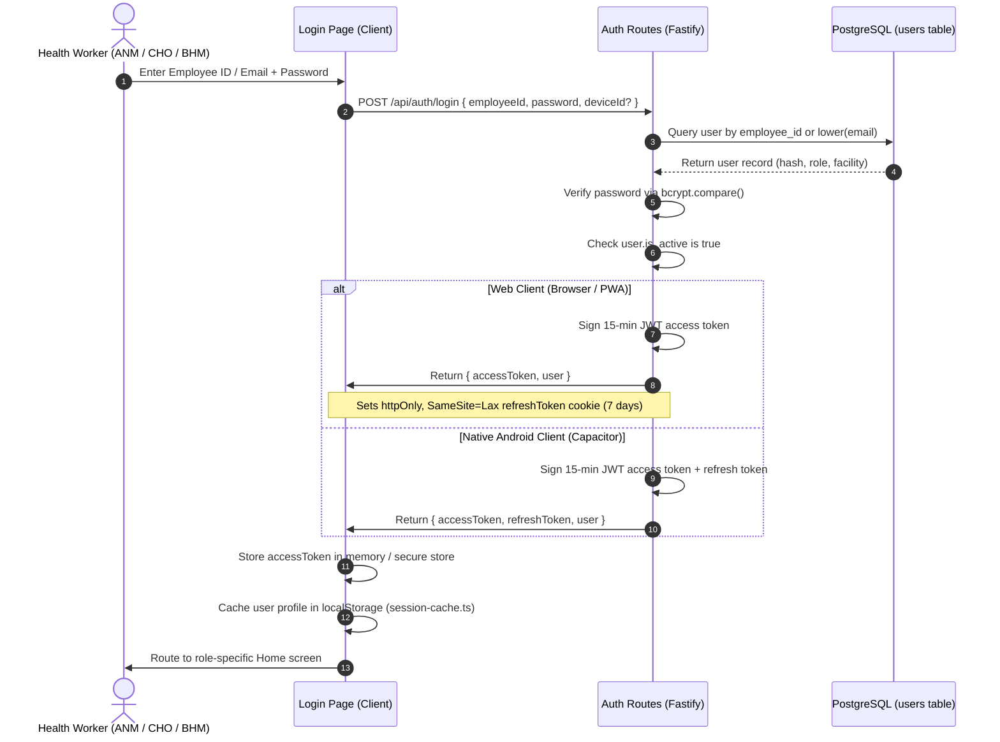
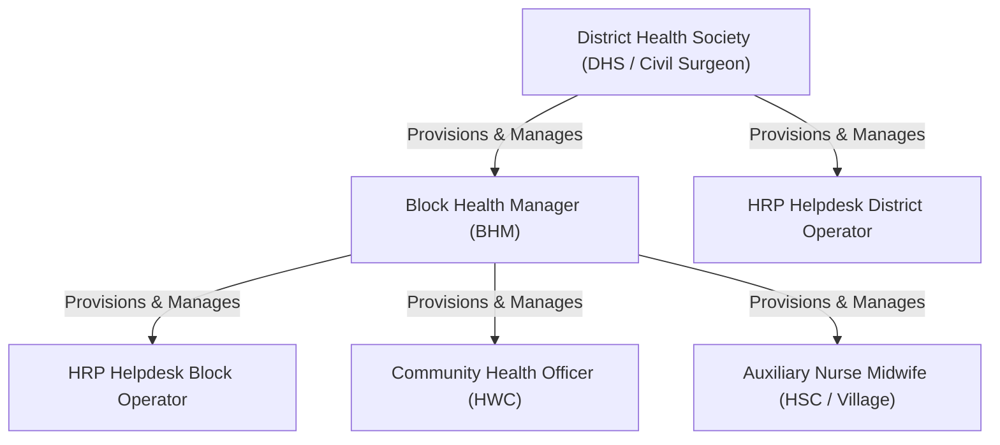
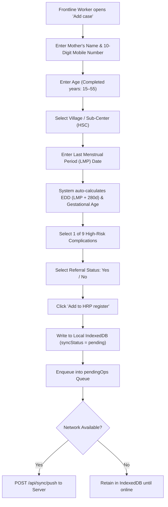
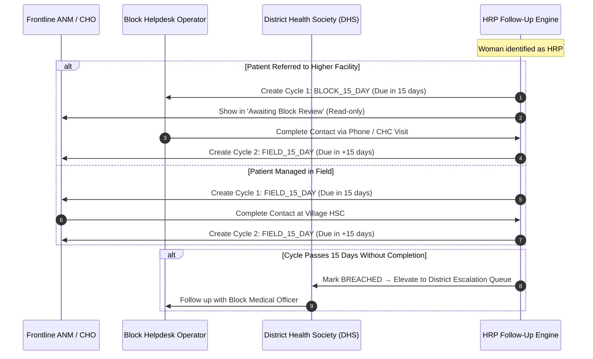
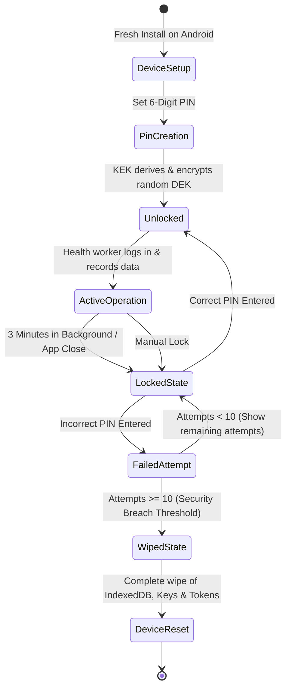

# Matru Suraksha — Application Workflows

This document details the primary operational and clinical workflows implemented in **Matru Suraksha**, tracking actors, preconditions, step-by-step logic, state transitions, and exception handling.

---

## 1. User Authentication & Session Lifecycle

Matru Suraksha provides a unified authentication pipeline supporting web browsers, PWA installations, and standalone Android Capacitor packages.

### 1.1 Session Refresh Workflow
- **Trigger:** An API request returns HTTP 401 Unauthorized due to an expired access token.
- **Web Execution:** `packages/client/src/lib/api.ts` automatically issues `POST /api/auth/refresh`. The browser sends the `refreshToken` cookie. The server validates the cookie, mints a fresh 15-minute access token, and retries the original request.
- **Native Android Execution:** The client passes `{ refreshToken }` in the JSON request body.
- **Offline Tolerance:** If the refresh fails due to a network outage (`TypeError: Failed to fetch`), the client does **not** redirect to `/login`. Instead, it continues operating using the cached offline session (`session-cache.ts`).

---

## 2. Account Provisioning & Staff Hierarchy

Account creation follows the administrative authority structure of the health system:

### 2.1 Provisioning Rules
1. **Facility Subtree Scoping:** A creator can only assign users to facilities within their own administrative path. A BHM at `ARR_RANIGANJ` can only provision accounts at HSCs or HWCs subordinate to Raniganj Block.
2. **Fixed Roles:** A user's role cannot be modified in place. To change a worker's role, the administrator deactivates the existing account and creates a new one.
3. **Identifier Generation:** If an employee ID is omitted during creation, the server automatically generates one using a deterministic prefix (`HD-xxxx`, `ANM-xxxx`). Helpdesk operators log in using their email address.

---

## 3. High-Risk Pregnancy Intake Workflow

The intake form captures maternal metrics in seven streamlined fields:

### 3.1 Field-Level Options by Role
- **Field Roles (`ANM`, `CHO`):**
  - Referral choices: `Yes — Refer to CHC/FRU` vs `No — Routine Field Management`.
- **Block Roles (`BHM`, `HRP_HELPDESK_BLOCK`):**
  - Referral choices: `Refer to Sadar hospital` vs `Not needed`.
- **Automatic Scoring:** Any patient entered with an HRP complication is scored `AMBER` or `RED`, preventing high-risk pregnancies from being erroneously flagged as low risk.

---

## 4. ANC Visit & Vitals Capture Workflow

During routine or specialist visits, health workers record comprehensive antenatal care metrics:

1. **Patient Selection:** The health worker opens the patient record from the line list or search bar.
2. **Vitals Recording:**
   - Systolic BP (70–250 mmHg) and Diastolic BP (40–150 mmHg).
   - Hemoglobin (3.0–18.0 g/dL).
   - Maternal Weight (30–150 kg).
   - Fundal Height (10–50 cm) and Fetal Heart Rate (60–200 bpm).
3. **Obstetric Danger Sign Evaluation:** The worker screens for 8 critical signs:
   - Severe Hypertension / Pre-eclampsia
   - Gestational Diabetes (GDM)
   - Severe Anemia (Hb < 7 g/dL)
   - Vaginal Bleeding
   - Reduced Fetal Movement
   - Severe Persistent Headache
   - Visual Disturbances
   - Seizures / Convulsions
4. **Prophylactic Supplements:** Checkbox confirmation for Iron & Folic Acid (IFA), Calcium, and Albendazole.
5. **Dynamic Risk Score Recalculation:** The rule engine re-evaluates risk on every visit. If vitals cross danger thresholds (e.g., BP >= 140/90 or Hb < 7 g/dL), the patient's risk level escalates to `RED`.

---

## 5. 15-Day Follow-Up & Escalation Cycle

Every pregnancy marked as high risk (`isHrp = true`) enters an automated 15-day contact schedule:

### 5.1 Status Triad
- **`COMPLETE` (Green):** Contact completed and recorded with attribution (timestamp and user).
- **`PENDING` (Amber):** Within the active 15-day window, awaiting outreach.
- **`NOT_REACHABLE` (Gray):** Health worker attempted contact but the mother could not be reached. The row remains open and logs the last attempt timestamp.

---

## 6. Zero-Trust Local Security & Device Lifecycle

On mobile handsets, patient identifiers are protected by a cryptographic hardware-software lock:

### 6.1 Remote Revocation
If a worker reports a lost or stolen handset:
1. The BHM or DHS opens the **Devices** management console (`/devices`).
2. The supervisor clicks **Revoke** on the affected device UUID.
3. The server sets `revoked_at = now()` in the `devices` table.
4. Next time the stolen device connects to sync, the API responds with HTTP 401 `DEVICE_REVOKED`.
5. Upon receiving this code, the client application immediately executes an emergency local database wipe and resets to the onboarding screen.
