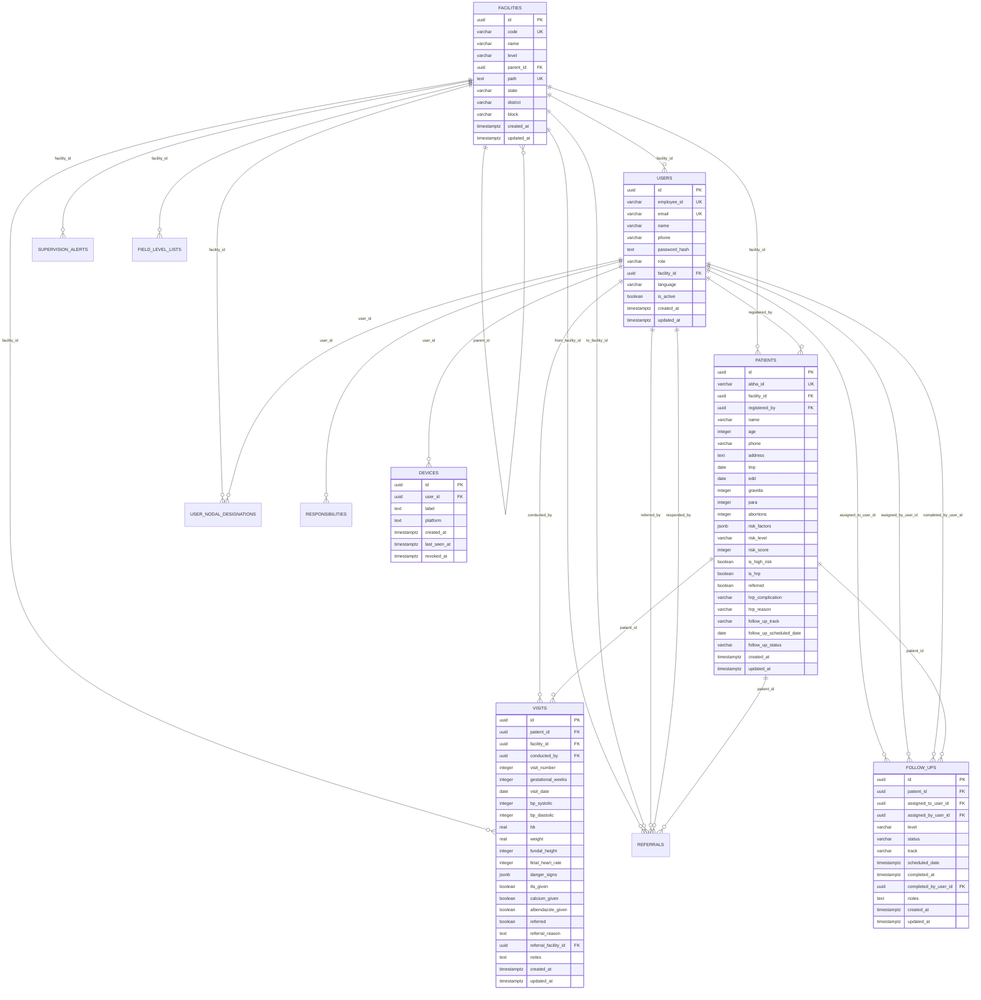

# Matru Suraksha — Database Documentation

This document provides a comprehensive technical reference for the PostgreSQL relational database powering **Matru Suraksha**, including table schemas, constraints, indexes, relationships, migrations, and seeding strategies.

---

## 1. Database Architecture & Design Principles

The database layer runs on **PostgreSQL 16** and is accessed programmatically using the **Kysely** query builder.

### Key Architectural Tenets:
1. **Materialized Path Hierarchies:** The public health facility tree is modeled using dot-separated materialized paths in `facilities.path` (e.g. `INDIA.BIHAR.ARARIA.RANIGANJ.HSC_SIKTI`). This enables single-query subtree authorization using PostgreSQL text pattern operations (`path = :scope OR path LIKE :scope || '.%'`).
2. **Defensive Referential Integrity:** Foreign keys enforce cascading deletions on dependent child records (such as visits and follow-ups when a patient record is purged), while preserving auditability on user references.
3. **Optimistic Concurrency & Audit Timestamps:** Core operational tables maintain `created_at` and `updated_at` timestamps with microsecond precision to support conflict detection during offline sync.
4. **JSONB Flexibility for Clinical Attributes:** Structured sets that vary across clinical guidelines (such as danger sign tags and risk factor lists) are stored as JSONB arrays, keeping table schemas stable while allowing indexed containment queries.

---

## 2. Entity-Relationship (ER) Diagram



---

## 3. Detailed Table Schemas

### 3.1 `facilities`
Stores the hierarchical administrative and clinical facilities.

| Column | Type | Constraints / Defaults | Description |
| :--- | :--- | :--- | :--- |
| `id` | `uuid` | `PRIMARY KEY DEFAULT gen_random_uuid()` | Unique facility identifier. |
| `code` | `varchar(50)` | `NOT NULL, UNIQUE` | Unique government code (e.g., `ARR_RANIGANJ`). |
| `name` | `varchar(255)` | `NOT NULL` | Facility display name. |
| `level` | `varchar(20)` | `NOT NULL CHECK (level IN ('STATE', 'DISTRICT', 'BLOCK', 'CHC', 'PHC', 'HWC', 'HSC', 'VILLAGE'))` | Administrative tier. |
| `parent_id` | `uuid` | `REFERENCES facilities(id)` | Parent facility in administrative tree. |
| `path` | `text` | `NOT NULL, UNIQUE` | Dot-separated materialized hierarchy path. |
| `state` | `varchar(100)` | `NOT NULL` | State name. |
| `district` | `varchar(100)`| `NOT NULL` | District name. |
| `block` | `varchar(100)` | `NOT NULL` | Block / Tehsil name. |
| `created_at` | `timestamptz` | `NOT NULL DEFAULT now()` | Record creation timestamp. |
| `updated_at` | `timestamptz` | `NOT NULL DEFAULT now()` | Last update timestamp. |

### 3.2 `users`
Stores authenticated health workers, clinical triage officers, and administrative supervisors.

| Column | Type | Constraints / Defaults | Description |
| :--- | :--- | :--- | :--- |
| `id` | `uuid` | `PRIMARY KEY DEFAULT gen_random_uuid()` | Unique user identifier. |
| `employee_id` | `varchar(50)` | `NOT NULL, UNIQUE` | Unique employee / worker code. |
| `email` | `varchar(120)` | Unique case-insensitive index where not null | Email address (used by helpdesk staff). |
| `name` | `varchar(255)` | `NOT NULL` | Full name of health worker. |
| `phone` | `varchar(20)` | `NOT NULL` | 10-digit mobile contact number. |
| `password_hash`| `text` | `NOT NULL` | Bcrypt password hash. |
| `role` | `varchar(30)` | `NOT NULL CHECK (role IN ('ANM', 'CHO', 'HRP_HELPDESK_BLOCK', 'BHM', 'HRP_HELPDESK_DISTRICT', 'DHS') OR (is_active = false AND role IN ('ASHA', 'STATE_ADMIN')))` | User role in system. |
| `facility_id` | `uuid` | `NOT NULL REFERENCES facilities(id)` | Home facility assignment. |
| `language` | `varchar(10)` | `NOT NULL DEFAULT 'hi'` | Preferred locale (`hi`, `en`). |
| `is_active` | `boolean` | `NOT NULL DEFAULT true` | Account active flag. |
| `created_at` | `timestamptz` | `NOT NULL DEFAULT now()` | Record creation timestamp. |
| `updated_at` | `timestamptz` | `NOT NULL DEFAULT now()` | Last update timestamp. |

### 3.3 `patients`
Stores registered pregnant women, maternal history, risk calculations, and follow-up states.

| Column | Type | Constraints / Defaults | Description |
| :--- | :--- | :--- | :--- |
| `id` | `uuid` | `PRIMARY KEY DEFAULT gen_random_uuid()` | Unique patient identifier. |
| `abha_id` | `varchar(14)` | `UNIQUE` | 14-digit Ayushman Bharat Health Account ID. |
| `facility_id` | `uuid` | `NOT NULL REFERENCES facilities(id)` | Village or HSC facility where registered. |
| `registered_by`| `uuid` | `NOT NULL REFERENCES users(id)` | Frontline worker who captured the registration. |
| `name` | `varchar(255)` | `NOT NULL` | Mother's full name. |
| `age` | `integer` | `NOT NULL CHECK (age >= 15 AND age <= 55)` | Completed age in years. |
| `phone` | `varchar(20)` | Nullable | Primary contact telephone number. |
| `address` | `text` | Nullable | Village / residential address text. |
| `lmp` | `date` | Nullable | Last Menstrual Period date. |
| `edd` | `date` | Nullable | Estimated Date of Delivery (LMP + 280 days). |
| `gravida` | `integer` | `NOT NULL DEFAULT 0` | Total number of pregnancies. |
| `para` | `integer` | `NOT NULL DEFAULT 0` | Number of live births delivered. |
| `abortions` | `integer` | `NOT NULL DEFAULT 0` | Number of previous miscarriages/abortions. |
| `risk_factors` | `jsonb` | `NOT NULL DEFAULT '[]'` | Array of identified clinical risk factor keys. |
| `risk_level` | `varchar(10)` | `NOT NULL DEFAULT 'GREEN' CHECK (risk_level IN ('GREEN', 'AMBER', 'RED'))` | Categorical risk classification. |
| `risk_score` | `integer` | `NOT NULL DEFAULT 0` | Algorithmic numeric score (0–100). |
| `is_high_risk` | `boolean` | `NOT NULL DEFAULT false` | True when risk_level is AMBER or RED. |
| `is_hrp` | `boolean` | `NOT NULL DEFAULT false` | True when enrolled into high-risk tracking. |
| `hrp_complication`| `varchar(40)`| Nullable | One of 9 standardized HRP complications. |
| `hrp_reason` | `varchar(40)` | Nullable | Category classification of complication. |
| `referred` | `boolean` | `NOT NULL DEFAULT false` | True if referred to higher facility. |
| `follow_up_track`| `varchar(40)`| `CHECK (follow_up_track IN ('BLOCK_15_DAY', 'FIELD_15_DAY'))` | Active 15-day follow-up stage. |
| `follow_up_scheduled_date`| `timestamptz`| Nullable | Target due date for active cycle. |
| `follow_up_status`| `varchar(20)`| `NOT NULL DEFAULT 'PENDING' CHECK (follow_up_status IN ('PENDING', 'COMPLETE', 'NOT_REACHABLE'))` | Status of current cycle. |
| `asha_name` | `varchar(255)` | Nullable | Linked ASHA worker name. |
| `asha_phone` | `varchar(20)` | Nullable | Linked ASHA worker contact phone. |
| `created_at` | `timestamptz` | `NOT NULL DEFAULT now()` | Record creation timestamp. |
| `updated_at` | `timestamptz` | `NOT NULL DEFAULT now()` | Last update timestamp. |

### 3.4 `visits`
Logs antenatal care contacts, maternal vitals, danger signs, and supplements.

| Column | Type | Constraints / Defaults | Description |
| :--- | :--- | :--- | :--- |
| `id` | `uuid` | `PRIMARY KEY DEFAULT gen_random_uuid()` | Unique ANC visit identifier. |
| `patient_id` | `uuid` | `NOT NULL REFERENCES patients(id) ON DELETE CASCADE` | Linked patient. |
| `facility_id` | `uuid` | `NOT NULL REFERENCES facilities(id)` | Facility where visit was conducted. |
| `conducted_by` | `uuid` | `NOT NULL REFERENCES users(id)` | Health worker who evaluated the patient. |
| `visit_number` | `integer` | `NOT NULL CHECK (visit_number >= 1 AND visit_number <= 8)` | ANC visit sequence number (1 to 8). |
| `gestational_weeks`| `integer`| `NOT NULL` | Gestational age in completed weeks. |
| `visit_date` | `date` | `NOT NULL` | Calendar date of examination. |
| `bp_systolic` | `integer` | Nullable (Range: 70–250) | Systolic blood pressure (mmHg). |
| `bp_diastolic` | `integer` | Nullable (Range: 40–150) | Diastolic blood pressure (mmHg). |
| `hb` | `real` | Nullable (Range: 3.0–18.0) | Hemoglobin concentration (g/dL). |
| `weight` | `real` | Nullable (Range: 30.0–150.0)| Maternal weight (kg). |
| `fundal_height`| `integer` | Nullable (Range: 10–50) | Symphysis-fundal height (cm). |
| `fetal_heart_rate`| `integer`| Nullable (Range: 60–200) | Fetal heart rate (bpm). |
| `danger_signs` | `jsonb` | `NOT NULL DEFAULT '[]'` | Screened danger sign identifiers. |
| `ifa_given` | `boolean` | `NOT NULL DEFAULT false` | IFA tablets provided. |
| `calcium_given`| `boolean` | `NOT NULL DEFAULT false` | Calcium supplements provided. |
| `albendazole_given`| `boolean`| `NOT NULL DEFAULT false` | Deworming dose provided. |
| `referred` | `boolean` | `NOT NULL DEFAULT false` | Referral recommended during visit. |
| `referral_reason`| `text` | Nullable | Clinical reason for referral. |
| `referral_facility_id`| `uuid` | `REFERENCES facilities(id)` | Target referral facility. |
| `notes` | `text` | Nullable | Free-text clinical observation notes. |
| `created_at` | `timestamptz` | `NOT NULL DEFAULT now()` | Record creation timestamp. |
| `updated_at` | `timestamptz` | `NOT NULL DEFAULT now()` | Last update timestamp. |

### 3.5 `follow_ups`
Manages the structured 15-day high-risk pregnancy monitoring cycles.

| Column | Type | Constraints / Defaults | Description |
| :--- | :--- | :--- | :--- |
| `id` | `uuid` | `PRIMARY KEY DEFAULT gen_random_uuid()` | Unique follow-up cycle identifier. |
| `patient_id` | `uuid` | `NOT NULL REFERENCES patients(id) ON DELETE CASCADE` | Linked patient. |
| `assigned_to_user_id`| `uuid`| `NOT NULL REFERENCES users(id)` | Active owner responsible for outreach. |
| `assigned_by_user_id`| `uuid`| `NOT NULL REFERENCES users(id)` | Supervisor or system who assigned cycle. |
| `level` | `varchar(20)` | `NOT NULL CHECK (level IN ('BLOCK_NODAL', 'CHO', 'ANM'))` | Organizational tier of the contact. |
| `status` | `varchar(20)` | `NOT NULL DEFAULT 'PENDING' CHECK (status IN ('PENDING', 'COMPLETE', 'NOT_REACHABLE'))` | Contact status. |
| `track` | `varchar(40)` | `NOT NULL CHECK (track IN ('BLOCK_15_DAY', 'FIELD_15_DAY'))` | Cycle stage identifier. |
| `scheduled_date`| `timestamptz`| `NOT NULL` | Due date of the 15-day window. |
| `completed_at` | `timestamptz`| Nullable | Timestamp when contact was closed. |
| `completed_by_user_id`| `uuid`| `REFERENCES users(id)` | Worker who executed the contact. |
| `notes` | `text` | Nullable | Outreach outcome notes. |
| `created_at` | `timestamptz` | `NOT NULL DEFAULT now()` | Record creation timestamp. |
| `updated_at` | `timestamptz` | `NOT NULL DEFAULT now()` | Last update timestamp. |

### 3.6 `devices`
Tracks enrolled mobile hardware and enables immediate remote revocation for lost or stolen devices.

| Column | Type | Constraints / Defaults | Description |
| :--- | :--- | :--- | :--- |
| `id` | `uuid` | `PRIMARY KEY` | Client-generated device UUID. |
| `user_id` | `uuid` | `NOT NULL REFERENCES users(id) ON DELETE CASCADE` | User authenticated on device. |
| `label` | `text` | Nullable | Handset model / manufacturer label. |
| `platform` | `text` | `NOT NULL DEFAULT 'web' CHECK (platform IN ('web', 'android'))` | Client platform. |
| `created_at` | `timestamptz` | `NOT NULL DEFAULT now()` | First enrollment timestamp. |
| `last_seen_at` | `timestamptz`| `NOT NULL DEFAULT now()` | Most recent API communication. |
| `revoked_at` | `timestamptz`| Nullable | Revocation timestamp; blocks all sync. |

---

## 4. Database Indexing Strategy

To guarantee rapid query response times under high concurrency and deep administrative hierarchies, specific indexes are maintained:

```sql
-- Facility Path Hierarchy Search
CREATE INDEX idx_facilities_path_pattern ON facilities (path text_pattern_ops);
CREATE UNIQUE INDEX facilities_path_key ON facilities (path);
CREATE INDEX idx_facilities_parent ON facilities (parent_id);

-- Scoped Patient Queries
CREATE INDEX idx_patients_facility_updated ON patients (facility_id, updated_at DESC);
CREATE INDEX idx_patients_risk_level ON patients (risk_level);
CREATE INDEX idx_patients_is_hrp ON patients (is_hrp);
CREATE INDEX idx_patients_follow_up_status ON patients (follow_up_status);
CREATE INDEX idx_patients_follow_up_scheduled ON patients (follow_up_scheduled_date);

-- Follow-Up Worklists & Escalation Detection
CREATE INDEX idx_follow_ups_patient ON follow_ups (patient_id);
CREATE INDEX idx_follow_ups_assigned_to ON follow_ups (assigned_to_user_id);
CREATE INDEX idx_follow_ups_status ON follow_ups (status);
CREATE INDEX idx_follow_ups_scheduled ON follow_ups (scheduled_date);
CREATE INDEX idx_follow_ups_scheduled_status ON follow_ups (scheduled_date, status);
CREATE INDEX idx_follow_ups_assigned_track ON follow_ups (assigned_to_user_id, track);

-- Security & Device Enforcement
CREATE INDEX idx_devices_user ON devices (user_id);
CREATE INDEX idx_devices_active ON devices (user_id) WHERE revoked_at IS NULL;
CREATE UNIQUE INDEX users_email_unique ON users (lower(email)) WHERE email IS NOT NULL;
```

---

## 5. Migration & Seeding Lifecycle

- **Migration Tooling:** Managed via `packages/server/src/db/migrate.ts`. Migrations are raw SQL files placed in `packages/server/migrations/` and executed sequentially.
- **Safety Mechanism:** A PostgreSQL advisory lock (`727001`) prevents concurrent migration execution across multiple server instances.
- **Checksum Verification:** Every migration's SHA-256 hash is recorded in `schema_migrations`. If a previously applied migration file is modified, the migration runner halts with an integrity error.
- **Seeding Guard:** `packages/server/src/db/seed-guard.ts` inspects database row counts. In production environments (`NODE_ENV=production`), seed scripts abort unless explicitly overridden, protecting real operational data.
