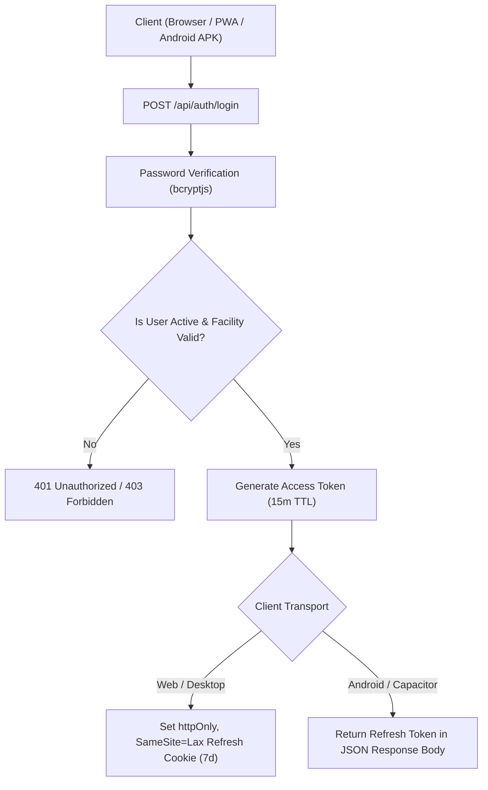

# Matru Suraksha — Authentication and Authorization

This document provides a comprehensive technical breakdown of identity, authentication, session management, access control, and facility-scoping boundaries implemented across **Matru Suraksha**.

---

## 1. Authentication Architecture

Matru Suraksha provides a dual-transport authentication model designed to satisfy both standard desktop browsers (for supervisors and helpdesk staff) and offline-capable Android mobile devices (for frontline ANMs).



### 1.1 Password Hashing & Storage
- **Algorithm:** Passwords are encrypted using **`bcryptjs`** with automatic salt generation.
- **Complexity Requirement:** Enforced via `LoginSchema` and `CreateStaffSchema` (minimum 8 characters; production deployments mandate >= 12 characters with symbol and numeric complexity).
- **Storage:** Only the resulting bcrypt hash is persisted in `users.password_hash`. Raw passwords never touch database logs or application traces.

### 1.2 Access & Refresh Tokens
- **Access Tokens (JWT):**
  - **Lifetime:** 15 minutes (`JWT_ACCESS_TTL=15m`).
  - **Signing:** HMAC-SHA-256 signed using `JWT_SECRET` (must be at least 32 characters in production).
  - **Payload:**
    ```json
    {
      "sub": "11111111-1111-4111-8111-111111111111",
      "role": "ANM",
      "facilityId": "22222222-2222-4222-8222-222222222222",
      "facilityPath": "ARR_RANIGANJ.HSC_SIKTI",
      "dev": "550e8400-e29b-41d4-a716-446655440000",
      "iat": 1731168000,
      "exp": 1731168900
    }
    ```
- **Refresh Tokens:**
  - **Lifetime:** 7 days (`JWT_REFRESH_TTL=7d`).
  - **Signing:** Signed using a dedicated `JWT_REFRESH_SECRET` that must be cryptographically distinct from `JWT_SECRET`.
  - **Web Security:** On desktop browsers, the refresh token is stored inside an `httpOnly`, `SameSite=Lax` cookie. It is completely inaccessible to client JavaScript, preventing XSS-based token exfiltration.
  - **Native Android Security:** In standalone APK builds, the refresh token is encrypted at rest using the local PIN-derived key (`packages/client/src/lib/session-cache.ts`).

### 1.3 Device Binding & Handset Revocation
Mobile clients supply their unique handset identifier in the `X-Device-Id` HTTP header. During the `app.authenticate` pre-handler:
1. If the token contains a `dev` claim, it must match the `X-Device-Id` header.
2. The server queries `devices` (`packages/server/src/services/devices.ts`).
3. If `revoked_at` is non-null, the server rejects the request with HTTP 401 and code `DEVICE_REVOKED`. This invalidates the session immediately, regardless of remaining JWT lifetime.

---

## 2. Authorization Engine & Action Matrix

Matru Suraksha implements fine-grained **Role-Based Access Control (RBAC)** coupled with **Attribute-Based Facility Scoping (ABAC)**.

### 2.1 Active System Roles

```
ANM  →  CHO  →  HRP_HELPDESK_BLOCK  →  BHM  →  HRP_HELPDESK_DISTRICT  →  DHS
```

1. **`ANM` (Auxiliary Nurse Midwife):** Village and HSC level field clinician. Enrolls pregnant women, conducts ANC checkups, logs vitals, and executes field follow-ups.
2. **`CHO` (Community Health Officer):** Facility-level clinician at Health & Wellness Centers (HWCs). Conducts clinical triage, reviews line-lists, and performs ANC examinations.
3. **`HRP_HELPDESK_BLOCK`:** Block-level telephone and desk operator. Owns the initial 15-day contact for referred high-risk pregnancies (`BLOCK_15_DAY`) and monitors the block line list.
4. **`BHM` (Block Health Manager):** Administrative block lead. Dispatches cases, manages supervision alerts, and provisions ANM, CHO, and Block Helpdesk accounts.
5. **`HRP_HELPDESK_DISTRICT`:** District hospital helpdesk operator. Coordinates inter-block transfers and manages the district-wide escalation worklist.
6. **`DHS` (District Health Society / Civil Surgeon):** District administrative authority. Oversees district KPIs, resolves breached follow-ups, and provisions BHM and District Helpdesk staff.

### 2.2 Permissions Matrix (`assertCan`)

Defined in `packages/server/src/authz/policy.ts`:

| Action | ANM | CHO | HRP_HELPDESK_BLOCK | BHM | HRP_HELPDESK_DISTRICT | DHS | Notes |
| :--- | :---: | :---: | :---: | :---: | :---: | :---: | :--- |
| `patient:read` | Yes | Yes | Yes | Yes | Yes | Yes | Scoped to facility subtree. |
| `patient:write` | Yes | Yes | Yes | Yes | No | No | Clinical registration and updates. |
| `patient:delete`| No | No | No | Yes | No | Yes | Restricted administrative action. |
| `visit:read` | Yes | Yes | Yes | Yes | Yes | Yes | Scoped to facility subtree. |
| `visit:write` | Yes | Yes | Yes | Yes | No | No | Gated to clinical roles. |
| `visit:delete` | No | No | No | No | No | No | Immutable clinical history. |
| `followup:manage`| Yes | Yes | Yes | Yes | Yes | Yes | Close contacts or dispatch lists. |
| `staff:manage` | No | No | No | Yes | No | Yes | Account provisioning. |
| `staff:read` | No | No | Yes | Yes | Yes | Yes | Staff directory querying. |
| `device:revoke` | No | No | No | Yes | No | Yes | Handset revocation. |
| `alert:read` | No | Yes | No | Yes | No | Yes | Supervision alerts. |
| `alert:acknowledge`| No | Yes | No | Yes | No | Yes | Clear supervision alerts. |
| `sync:push` | Yes | Yes | Yes | Yes | Yes | Yes | Push offline mutation queue. |
| `sync:read` | Yes | Yes | Yes | Yes | Yes | Yes | Pull cohort updates. |

---

## 3. Hierarchical Facility Scoping (ABAC)

Even if a user's role permits an action (e.g., `patient:read`), the user can only access records located within their assigned **facility subtree**.

### 3.1 Materialized Path Scoping
Every facility has a dot-delimited path indicating its administrative hierarchy:
```
INDIA.BIHAR.ARARIA.RANIGANJ             (Block CHC)
INDIA.BIHAR.ARARIA.RANIGANJ.HSC_SIKTI   (Village Sub-Center)
```

When an actor performs an operation on a facility target:
```typescript
export function isPathInSubtree(targetPath: string, rootPath: string): boolean {
  if (targetPath === rootPath) return true;
  return targetPath.startsWith(`${rootPath}.`);
}
```

### 3.2 SQL Predicate Generation
When querying line lists, the server injects the scope filter directly into the SQL query:
```typescript
export function facilityScopePredicate(actor: ActorScope, pathColumn: string) {
  return (eb: ExpressionBuilder<any, any>) =>
    eb.or([
      eb(pathColumn, "=", actor.homeFacilityPath),
      eb(pathColumn, "like", `${actor.homeFacilityPath}.%`)
    ]);
}
```

### 3.3 Isolation Guarantees
- A BHM at `INDIA.BIHAR.ARARIA.RANIGANJ` can view records from all subordinate HSCs and HWCs within Raniganj.
- A BHM at `INDIA.BIHAR.ARARIA.RANIGANJ` **cannot** view records from `INDIA.BIHAR.ARARIA.FORBESGANJ`. The query returns an empty set or HTTP 404, preventing cross-block exposure.
- An ANM assigned to `HSC_SIKTI` can only view and mutate records originating from `HSC_SIKTI`.

---

## 4. Delegated Account Provisioning Matrix

To decentralize administration while maintaining governance, account creation is strictly delegated:

| Supervisor Role | Permitted Target Roles | Permitted Facility Assignment |
| :--- | :--- | :--- |
| **`DHS`** | `BHM`, `HRP_HELPDESK_DISTRICT` | Within district boundaries (`DISTRICT`, `BLOCK`, `CHC`). |
| **`BHM`** | `ANM`, `CHO`, `HRP_HELPDESK_BLOCK` | Within supervisor's block subtree (`HWC`, `HSC`, `VILLAGE`). |
| **Others** | None | Prohibited from creating or editing accounts. |

Attempts by any other role to call `/api/staff` are rejected with HTTP 403 Forbidden (`ROLE_NOT_PERMITTED`).

---

## 5. Security Middleware & HTTP Hardening

All Fastify responses include strict HTTP security headers:
- `X-Content-Type-Options: nosniff` — Prevents MIME-sniffing.
- `X-Frame-Options: DENY` — Protects against clickjacking.
- `Referrer-Policy: strict-origin-when-cross-origin` — Restricts referrer leaks.
- `Strict-Transport-Security: max-age=31536000` — Enforces HTTPS in production.
- **Rate Limiting:**
  - `/api/auth/*`: 100 requests / minute per IP.
  - `/api/sync/*`: 60 requests / minute per IP.
  - General API: 500 requests / minute per IP.
