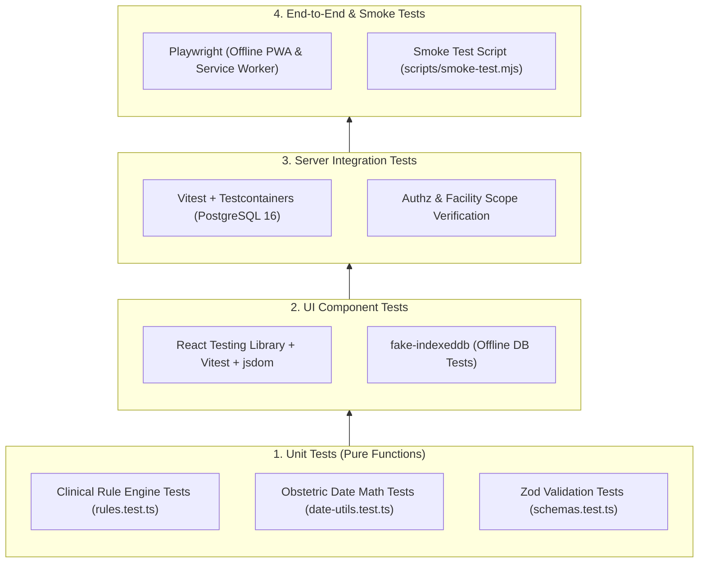

# Matru Suraksha — Testing and Quality Assurance

This document details the testing architecture, quality gates, coverage requirements, security scans, and performance budgets enforced across **Matru Suraksha**.

---

## 1. Testing Philosophy & Test Pyramid

Testing in Matru Suraksha is structured into four distinct layers:



### Key Principles:
- **Zero Mocking of Core Domain Rules:** The clinical risk scoring engine (`rules.ts`) and date calculation utilities (`date-utils.ts`) are tested with pure deterministic inputs and zero mocks.
- **Real Database Integration:** Server route testing uses real PostgreSQL databases managed via Testcontainers, ensuring that complex SQL joins, constraints, and transactions are evaluated against actual Postgres behavior.
- **Offline Simulation:** Client repositories and sync queues are tested using `fake-indexeddb` to verify that offline writes, blind indexes, and encryption round-trip without network dependencies.

---

## 2. Test Execution Commands

### 2.1 Complete Workspace Test Suite
```bash
# Execute tests across all packages (Shared, Server, Client)
npm test

# Run tests with code coverage collection
npm run coverage
```

### 2.2 Package-Specific Test Suites
```bash
# Shared library tests (pure unit tests)
npm test --workspace=packages/shared

# Server unit tests (no database dependency)
npm run test:unit --workspace=packages/server

# Server integration tests (requires Docker for Testcontainers)
npm run test:integration --workspace=packages/server

# Client component & offline repository tests
npm test --workspace=packages/client

# Client end-to-end browser tests
npm run test:e2e --workspace=packages/client
```

### 2.3 Smoke Testing
Exercises full authentication, cookie exchange, patient listing, and proxy routing against a live instance:
```bash
# Direct API smoke test on port 3000
npm run test:smoke

# Smoke test through the Vite frontend proxy on port 5173
npm run test:smoke:proxy
```

---

## 3. Coverage Enforcement on Changed Lines

Unlike legacy systems that enforce blanket repository-wide coverage (which disincentivizes touching legacy modules), Matru Suraksha enforces a **Changed-Line Coverage Gate**:

- **Threshold:** **`>= 80%`** line coverage on newly added or modified lines of code.
- **Enforcement Script:** `scripts/check-changed-coverage.mjs`.
- **How it Works:**
  1. Computes `git diff` against the base branch (`origin/main`).
  2. Extracts executable lines changed in the current pull request.
  3. Cross-references changed lines against Vitest's V8 coverage report (`lcov.info`).
  4. Fails the build if coverage on executable changed lines falls below 80%.
- **Excluded Files:** Build configs (`*.config.*`), CLI scripts (`migrate.ts`, `seed.ts`), entrypoints (`index.ts`, `main.tsx`), and tests.

---

## 4. Security Scanners & Dependency Auditing

Security testing is automated across pre-commit, task completion, and CI stages:

| Tool | Focus Area | Command / Config | Execution Stage |
| :--- | :--- | :--- | :--- |
| **`scan-secrets.mjs`** | Local static secret detection | `npm run security:secrets` | Every edit (`check:fast`) |
| **Gitleaks** | Git history secret scanning | GitHub Action (`v2.3.9`) | CI Pull Requests |
| **Semgrep** | AST vulnerability analysis | `npm run security:semgrep` | CI Review (`check:full`) |
| **OSV-Scanner** | Open-source vulnerability audit | `npm run security:osv` | CI Review (`check:full`) |

### Semgrep Rules:
Configured with `p/default` and `p/owasp-top-ten`. Scans for SQL injection patterns, unsafe regexes, prototype pollution, and hardcoded JWT secrets.

### OSV-Scanner Configuration (`osv-scanner.toml`):
Audits all lockfile dependencies against Google's Open Source Vulnerabilities database. Documented dev-dependency exemptions (with architectural rationales) are isolated in `osv-scanner.toml`.

---

## 5. Performance, Accessibility & Bundle Budgets

Preview deployments undergo automated Lighthouse, Axe, and size-limit verification:

```bash
# Bundle size audit
npm run check:bundle

# Performance audit (requires running preview URL)
npm run check:perf

# Accessibility audit (requires running preview URL)
npm run check:a11y
```

### Binding Quality Thresholds (`CONSTRAINTS.md`):

| Metric | Budget | Tool | Failure Criteria |
| :--- | :--- | :--- | :--- |
| **Largest Contentful Paint (LCP)**| `<= 2500 ms` | Lighthouse CI | LCP > 2.5s on mobile profile. |
| **Cumulative Layout Shift (CLS)** | `<= 0.1` | Lighthouse CI | CLS > 0.1. |
| **Performance Score** | `>= 90` | Lighthouse CI | Score < 90. |
| **Main JS Bundle (gzipped)** | `<= 170 kB` | `@size-limit/preset-app` | Bundle > 170 kB. |
| **Accessibility (WCAG 2.1 AA)** | Zero violations | `@axe-core/cli` | Any critical or serious violation. |
