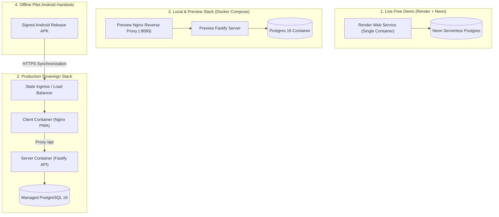

# Matru Suraksha — Deployment and Infrastructure

This document details the infrastructure topology, container packaging, deployment strategies, and operational runbooks for **Matru Suraksha**.

---

## 1. Deployment Topologies Overview

Matru Suraksha supports four deployment targets:



---

## 2. Container Packaging Strategy

The repository maintains three Dockerfiles in the root directory:

### 2.1 `Dockerfile` (Single-Origin Demo Image)
- **Use Case:** Deployed to free cloud tiers (e.g., Render.com via `render.yaml`).
- **Architecture:** Combines the compiled React PWA and the Fastify backend server into a single container image. The Fastify server serves the static client files via `@fastify/static` and handles API requests under `/api`.
- **Startup:** Automatically runs `npm run db:migrate` and `npm run db:seed` during container initialization (`docker-entrypoint.sh`).
- **Data Policy:** Strictly for synthetic demonstration data (`https://hrp-demo.onrender.com`). **Never load real patient data into this instance.**

### 2.2 `Dockerfile.server` (Production Backend Image)
- **Use Case:** Standalone backend container deployed behind a reverse proxy or load balancer.
- **Base Image:** `node:20-alpine`.
- **Build Strategy:** Multi-stage build. Installs root dependencies, builds `@hrp/shared`, compiles `@hrp/server` via `tsc`, prunes development dependencies, and outputs `dist/index.js`.
- **Port:** Exposes internal TCP port `3000`.

### 2.3 `Dockerfile.client` (Production Frontend Image)
- **Use Case:** Standalone frontend container serving the PWA and acting as the API edge proxy.
- **Base Image:** `nginx:1.27-alpine`.
- **Build Strategy:** Multi-stage build using `node:20-alpine` to build `@hrp/shared` and compile `@hrp/client` via Vite. The static assets are copied to Nginx web root (`/usr/share/nginx/html`).
- **Reverse Proxy Routing:** Nginx proxies `/api/`, `/health`, `/ready`, and `/api/version` directly to the server container, keeping browser requests strictly same-origin and preventing cross-origin cookie failures.

---

## 3. Production Deployment Execution (`docker-compose.prod.yml`)

The production Compose configuration consumes pre-built, tagged container registry images and executes a fail-closed bootstrap sequence.

### 3.1 Required Production Environment Variables:
```bash
# Set registry images tagged with git SHA
export HRP_SERVER_IMAGE="registry.example.in/hrp-server:1a0cea6"
export HRP_CLIENT_IMAGE="registry.example.in/hrp-client:1a0cea6"

# Set cryptographic secrets (minimum 32 random characters each)
export HRP_DB_PASSWORD="<production-database-password>"
export HRP_JWT_SECRET="<random-32-character-secret>"
export HRP_JWT_REFRESH_SECRET="<different-random-32-character-secret>"
```

### 3.2 Bootstrap Sequence:
1. **Migration Job Runs First:** A dedicated `migration` container spins up, connects to PostgreSQL, acquires advisory lock `727001`, and applies all pending migrations in `packages/server/migrations/`.
2. **Server Waits for Migrations:** The `server` container depends on `migration: service_completed_successfully`. It boots and starts accepting traffic on port `3000`.
3. **Client Waits for Server Readiness:** The `client` container depends on `server: service_healthy` (which polls `/ready`). Once the server is ready, Nginx begins serving client requests on port `80`.

To start the production stack:
```bash
docker compose -f docker-compose.prod.yml up -d
```

---

## 4. Android APK Delivery Pipeline (`.github/workflows/android.yml`)

Because pilot ANMs operate in remote areas without Play Store access, Android packages are built and distributed as signed, sideloadable APKs:

1. **Trigger:** Push of a version tag (e.g. `v1.0.0`) or manual trigger via GitHub `workflow_dispatch`.
2. **Build Process:**
   - Compiles `@hrp/shared` and `@hrp/client`.
   - Runs `npx cap sync android`.
   - Decodes the release signing keystore from GitHub Secrets (`ANDROID_KEYSTORE_BASE64`).
   - Executes Gradle release assembly: `./gradlew assembleRelease`.
3. **Artifact Generation:** Signs and zipaligns `matru-suraksha-<version>.apk` and generates a SHA-256 checksum file.
4. **Publishing:** Automatically drafts a GitHub Release containing the signed APK asset and SHA-256 hash.
5. **Distribution:** Handed to district IT via shared drive or local distribution for installation onto pilot handsets.

---

## 5. Backup, Restoration & Disaster Recovery

Operational database protection is governed by `docs/runbooks/backup-restore.md` and verified with `scripts/verify-backup.mjs`.

### 5.1 Automated Backup Routine
```bash
# Automated daily logical backup using pg_dump
docker exec -t hrp-db pg_dump -U hrp -d hrp -F c -b -v -f /backups/hrp_$(date +%Y%m%d_%H%M%S).dump
```

### 5.2 Verification Script
The backup verification utility (`node scripts/verify-backup.mjs`) automatically tests backup integrity by spinning up an ephemeral container, restoring the dump, and asserting row counts and referential integrity across core tables (`facilities`, `users`, `patients`).

### 5.3 Rollback Procedure
If a deployment fails:
1. Re-tag the previous known-good registry images in `docker-compose.prod.yml`.
2. Execute `docker compose -f docker-compose.prod.yml up -d`.
3. Database migrations are designed to be additive; breaking schema changes require an explicit forward-fixing migration.
