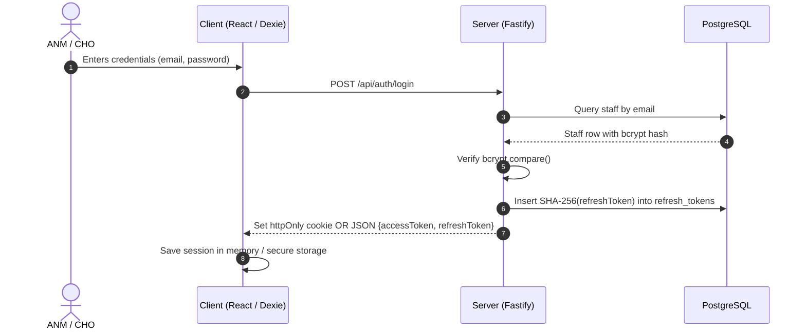
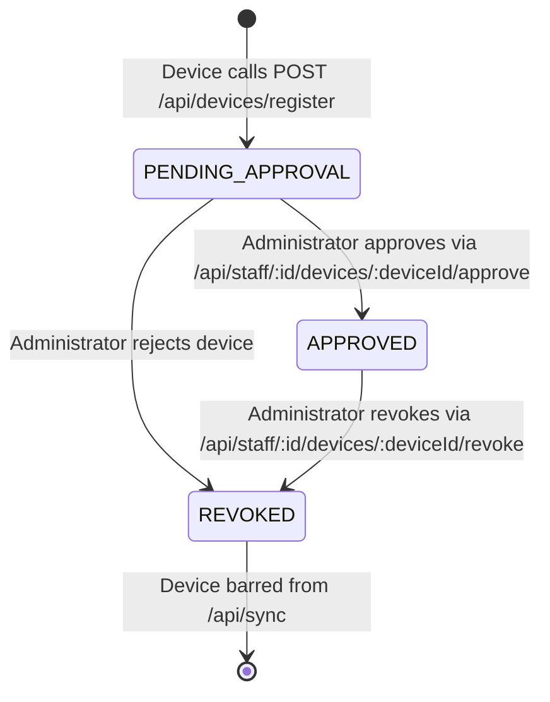
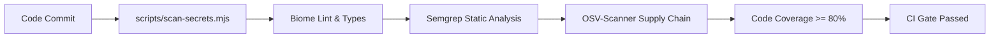

# Matru Suraksha — Security Documentation

This document describes the security architecture, threat model, cryptographic mechanisms, data protection safeguards, and compliance controls implemented across the **Matru Suraksha** platform.

---

## 1. Threat Model & Security Objectives

Matru Suraksha operates in rural Indian public health facilities where primary frontline users (ANMs, CHOs) utilize mobile Android tablets or shared desktop workstations, often in environments with intermittent internet connectivity and shared device access.

### 1.1 Threat Actors & Attack Vectors

| Threat Actor | Vector | Potential Impact | Mitigating Controls |
| :--- | :--- | :--- | :--- |
| **Device Thief / Opportunistic Finder** | Physical theft of tablet in the field | Access to cached offline patient records and clinical identifiers | AES-256-GCM field encryption, 6-digit PIN lock, 5-minute idle timeout, 10-attempt auto-wipe. |
| **Unauthorized Healthcare Worker** | Lateral escalation on shared clinic workstation | Viewing patients outside assigned facility jurisdiction | Attribute-Based Access Control (ABAC) with dot-separated facility path subtree scoping. |
| **Network Eavesdropper (MITM)** | Unsecured public or cellular network traffic interception | Interception of tokens or clinical sync payloads | Mandatory TLS 1.3 in transit, HTTP Strict Transport Security (HSTS), httpOnly secure cookies. |
| **Malicious API Caller** | Brute force or automated scraping attacks | Denial of service, credential stuffing | Fastify rate limiting (100 req/min auth, 500 req/min API), bcrypt password hashing (cost factor 10). |
| **Compromised Field Device** | Stolen credentials or cloned client state | Malicious or rogue data sync | Device registration workflow (`PENDING_APPROVAL` / `APPROVED`), administrative device revocation. |
| **Insider / Developer** | Accidental credential leakage in git repository | Unauthorized database or server infrastructure access | Automated CI secret scanner (`scripts/scan-secrets.mjs`), Gitleaks, environment variable isolation. |

---

## 2. Authentication & Session Security

The authentication system employs defense-in-depth spanning both web browsers and native Android APK environments.

### 2.1 Credential Storage & Hashing
- **Algorithm:** Passwords are hashed using `bcryptjs` with a work factor (salt rounds) of `10`.
- **Validation:** Minimum password length of 8 characters enforced by Zod schemas. Passwords are never returned in API responses or written to system logs.

### 2.2 Dual-Transport Token Model
To support both browser PWAs (where cookies mitigate XSS token theft) and native mobile apps (where cookie jars can be fragmented or restricted):
1. **Access Tokens:**
   - Lifetime: 15 minutes (`ACCESS_TOKEN_TTL_SEC = 900`).
   - Format: Signed JSON Web Token (JWT) containing `sub` (user ID), `role`, `facilityId`, and `facilityPath`.
   - Transport:
     - **Web:** Set in an `httpOnly`, `SameSite=Lax`, `Secure` cookie named `access_token`.
     - **Native Mobile:** Returned in JSON response body and passed via standard `Authorization: Bearer <token>` header.
2. **Refresh Tokens:**
   - Lifetime: 7 days (`REFRESH_TOKEN_TTL_SEC = 604800`).
   - Storage: Only the SHA-256 cryptographic hash (`token_hash`) of the refresh token is stored in the PostgreSQL `refresh_tokens` table alongside client IP address and user-agent string.
   - Rotation: Refresh tokens are single-use. When exchanged, the old refresh token is marked revoked, and a new key pair is generated.



---

## 3. Authorization & Facility Scope Enforcement

Authorization uses a centralized 24-action policy matrix coupled with facility hierarchy scoping.

### 3.1 Role Hierarchy
The 6 system roles have strictly defined responsibilities:
$$\text{ANM} \longrightarrow \text{CHO} \longrightarrow \text{HRP\_HELPDESK\_BLOCK} \longrightarrow \text{BHM} \longrightarrow \text{HRP\_HELPDESK\_DISTRICT} \longrightarrow \text{DHS}$$

### 3.2 Materialized Path Jurisdiction (ABAC)
Every facility possesses a dot-separated hierarchy string (e.g., `INDIA.BIHAR.ARARIA.RANIGANJ.HSC_SIKTI`).
- When a user queries or modifies records, their `facilityPath` token claim is matched against the target facility's path:
  ```sql
  WHERE facility_path = :userPath OR facility_path LIKE :userPath || '.%'
  ```
- Frontline ANMs at Sub-Centres can only read and write data in their specific HSC.
- Block officers (CHO, BHM, HRP_HELPDESK_BLOCK) can access all HSCs and PHCs within their block.
- District officers (DHS, HRP_HELPDESK_DISTRICT) have read and oversight access across all blocks within the district.

---

## 4. Field-Level Client Cryptography (Device Security)

To safeguard Protected Health Information (PHI) stored in client-side IndexedDB on frontline tablets, the application implements local field-level encryption.

### 4.1 Cryptographic Primitives
- **Algorithm:** AES-256-GCM (Authenticated Encryption with Associated Data).
- **Key Derivation Function:** PBKDF2 using SHA-256 with **600,000 iterations**.
- **Salt:** 16-byte cryptographically secure random value generated via `crypto.getRandomValues()`.
- **Initialization Vector (IV):** 12-byte cryptographically secure random IV generated per encryption operation.
- **Serialization:** Ciphertexts are prefixed and base64-encoded: `enc:v1:<base64-iv>:<base64-ciphertext>:<base64-auth-tag>`.

### 4.2 Key Management Lifecycle
1. **Device Encryption Key (DEK):** Derived entirely from a user-selected 6-digit PIN and device salt stored in local IndexedDB.
2. **Volatile In-Memory Hold:** The derived DEK exists solely in volatile JavaScript memory. It is never persisted to disk, local storage, or session storage.
3. **Locking & Destruction:**
   - Triggered by user action ("Lock App") or an automatic **5-minute idle timeout**.
   - Upon locking, the in-memory CryptoKey reference is set to `null` and garbage collected.
4. **Brute-Force Countermeasure:**
   - Failed PIN attempts increment a persistent counter.
   - If **10 consecutive incorrect attempts** occur, the client triggers an emergency wipe: all Dexie/IndexedDB databases, cached tokens, and encryption metadata are purged immediately.

---

## 5. Device Authorization & Revocation

Mobile devices running the offline sync engine must be provisioned and authorized before synching sensitive clinical records.

### 5.1 Registration State Machine


1. **Fingerprint & Metadata:** Devices register unique client identifiers, platform details (Android/Web), app version, and hardware fingerprint.
2. **Server Enforcement:** The sync route (`POST /api/sync`) validates the incoming `deviceId`. If the device is in `PENDING_APPROVAL` or `REVOKED` state, the server rejects the synchronization request with HTTP 403 Forbidden.

---

## 6. Server Infrastructure & Network Defenses

### 6.1 SQL Injection Prevention
All database queries are executed via the **Kysely** TypeScript query builder, utilizing native PostgreSQL parameterized queries. Direct string concatenation of SQL statements is strictly prohibited and enforced during code reviews and security scanning.

### 6.2 HTTP Security Headers
Fastify registers `@fastify/helmet` to deliver robust HTTP defense headers:
- `Content-Security-Policy`: Restricts script, style, and connect sources.
- `X-Frame-Options`: `DENY` to prevent clickjacking.
- `X-Content-Type-Options`: `nosniff` to eliminate MIME-type sniffing.
- `Strict-Transport-Security`: `max-age=31536000; includeSubDomains; preload`.
- `Referrer-Policy`: `strict-origin-when-cross-origin`.

### 6.3 Rate Limiting
Configured via `@fastify/rate-limit` using an in-memory sliding window:
- **Authentication endpoints (`/api/auth/*`):** Maximum 100 requests per minute per IP.
- **General API endpoints (`/api/*`):** Maximum 500 requests per minute per IP.
- Exceeding the rate limit returns HTTP 429 Too Many Requests with a `Retry-After` header.

### 6.4 Input Validation
Every endpoint executes strict Zod schema validation on `body`, `params`, and `querystring` before routing to business controllers. Unknown or unexpected properties are stripped or rejected.

---

## 7. Audit Logging & Non-Repudiation

Every clinical modification generates an audit record in the PostgreSQL `audit_logs` table:
- **Captured Attributes:**
  - `actor_staff_id`: Identifier of the authenticated staff member.
  - `action`: Specific action executed (e.g., `PATIENT_CREATE`, `VISIT_RECORD`, `SYNC_APPLIED`).
  - `entity_type`: Target entity (`PATIENT`, `VISIT`, `FOLLOW_UP`, `DEVICE`).
  - `entity_id`: Primary key of affected record.
  - `facility_path`: Facility context at the time of execution.
  - `ip_address`: Remote IP address of the client request.
  - `created_at`: Server timestamp (UTC).
  - `details`: JSON payload documenting changed fields or metadata.
- **PHI Masking in Logs:** Pino application logs redact direct patient identifiers (names, Aadhaar/ID numbers, phone numbers). Full clinical data is stored only in the relational database tables with access control.

---

## 8. Continuous Security Verification (CI Gates)

Security enforcement is integrated directly into the CI pipeline:



1. **Secret Scanning (`npm run security:secrets`):** Scans all tracked repository files for AWS tokens, private keys, database passwords, and high-entropy credentials using regex and Shannon entropy algorithms.
2. **Static Application Security Testing (`npm run security:semgrep`):** Evaluates TypeScript and SQL source code against OWASP Top 10 rules.
3. **Vulnerability Scanning (`npm run security:osv`):** Assesses `package-lock.json` against the Open Source Vulnerabilities (OSV) database for known CVEs.
4. **Retired Identifier Check (`npm run check:retired-identifiers`):** Prevents deprecated schema or security terms from entering production code or documentation.
