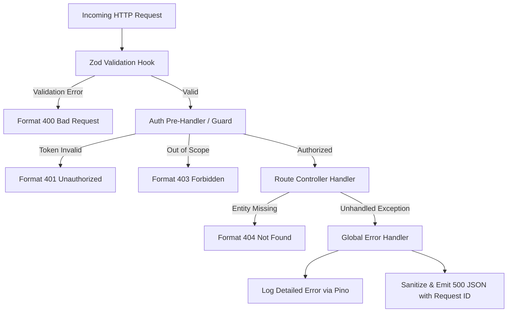
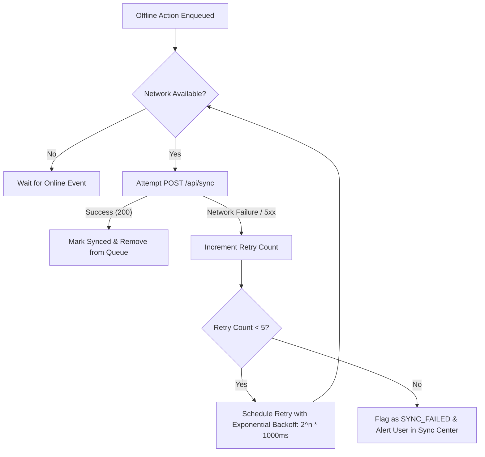

# Matru Suraksha — Error Handling & Logging

This document details the error handling strategy, logging architecture, request tracing, and client-side resilience mechanisms across the **Matru Suraksha** platform.

---

## 1. Design Principles

1. **Fail Securely:** Errors never expose stack traces, database schema details, or sensitive Protected Health Information (PHI) to clients.
2. **Predictable JSON Error Schema:** All API error responses adhere to standard HTTP status codes and a consistent JSON payload structure.
3. **Structured Tracing:** All server events are logged as structured JSON with unique correlation IDs (`req.id`) to allow end-to-end request tracing.
4. **Resilient Frontline Offline Operations:** Client-side storage and synchronization failures trigger automated retries with exponential backoff, rather than blocking healthcare workflows.

---

## 2. API Error Response Structure

All HTTP error responses generated by `@hrp/server` conform to the following schema:

```json
{
  "statusCode": 400,
  "error": "Bad Request",
  "message": "Validation failed for request payload",
  "code": "VALIDATION_ERROR",
  "details": [
    {
      "path": ["body", "systolicBp"],
      "message": "Expected integer between 40 and 300, received 20"
    }
  ],
  "requestId": "req-9b1deb4d-3b7d-4bad-9bdd-2b0d7b3dcb6d"
}
```

### 2.1 Standard HTTP Status Codes

| Status Code | Scenario | Typical Code |
| :--- | :--- | :--- |
| **400 Bad Request** | Zod payload validation failure, malformed JSON, unparseable UUID | `VALIDATION_ERROR` |
| **401 Unauthorized** | Missing, expired, or invalid JWT access token | `UNAUTHORIZED` |
| **403 Forbidden** | User lacks required role permission or target record is outside facility path jurisdiction | `FORBIDDEN` |
| **404 Not Found** | Requested patient, visit, facility, or device record does not exist | `NOT_FOUND` |
| **409 Conflict** | Concurrency conflict during offline sync (e.g. out-of-order version updates) | `CONFLICT` |
| **429 Too Many Requests**| Rate limit exceeded (auth or general API endpoints) | `RATE_LIMITED` |
| **500 Internal Error** | Unhandled server exception or database connectivity disruption | `INTERNAL_SERVER_ERROR` |

---

## 3. Server-Side Error Handling Architecture

Fastify handles errors through layered middleware and a centralized global error handler:



### 3.1 Custom Error Classes

Domain-specific errors are thrown in services and caught by the global error handler:

```typescript
// Example custom authorization error pattern
export class AuthzError extends Error {
  public readonly statusCode = 403;
  public readonly code = 'FORBIDDEN';

  constructor(message: string = 'Access denied: outside facility scope') {
    super(message);
    this.name = 'AuthzError';
  }
}

export class NotFoundError extends Error {
  public readonly statusCode = 404;
  public readonly code = 'NOT_FOUND';

  constructor(entity: string, id: string) {
    super(`${entity} with id '${id}' not found`);
    this.name = 'NotFoundError';
  }
}
```

### 3.2 Global Fastify Error Handler

The global handler catches all unhandled exceptions, guarantees that internal system internals are not leaked, and formats the output:

```typescript
server.setErrorHandler((error, request, reply) => {
  const statusCode = error.statusCode || 500;
  const requestId = request.id;

  // Log full stack trace server-side with request ID
  request.log.error({
    err: error,
    requestId,
    url: request.raw.url,
    method: request.raw.method,
  }, error.message);

  // Deliver sanitized client payload
  reply.status(statusCode).send({
    statusCode,
    error: error.name || 'InternalServerError',
    message: statusCode >= 500 ? 'An unexpected internal error occurred' : error.message,
    code: (error as any).code || (statusCode >= 500 ? 'INTERNAL_SERVER_ERROR' : 'ERROR'),
    details: (error as any).details,
    requestId,
  });
});
```

---

## 4. Pino Logging Architecture

The server uses **Pino** for high-throughput, structured JSON logging.

### 4.1 Configuration & Redaction

In production, Pino outputs single-line JSON to standard out. Sensitive fields are redacted to avoid recording credentials or PHI in log aggregators:

```typescript
const loggerConfig = {
  level: process.env.LOG_LEVEL || 'info',
  redact: {
    paths: [
      'req.headers.authorization',
      'req.headers.cookie',
      'body.password',
      'body.refreshToken',
      'body.phoneNumber',
      'body.aadhaarNumber',
      '*.password',
    ],
    remove: true,
  },
  timestamp: () => `,"time":"${new Date().toISOString()}"`,
};
```

### 4.2 Log Structure Example

```json
{
  "level": 30,
  "time": "2026-11-09T18:45:10.124Z",
  "pid": 2841,
  "hostname": "hrp-server-prod-1",
  "reqId": "req-4a8f903e-108a-4933-9111-cd83b167520e",
  "req": {
    "method": "POST",
    "url": "/api/patients",
    "remoteAddress": "103.21.124.8"
  },
  "res": {
    "statusCode": 201
  },
  "responseTime": 24.3,
  "msg": "request completed"
}
```

---

## 5. Client-Side Error Handling & Offline Recovery

### 5.1 React Error Boundary
A top-level React `ErrorBoundary` captures rendering and lifecycle failures:
- Prevents the entire white-screen crash on mobile tablets.
- Displays an offline-friendly recovery view ("An unexpected interface error occurred").
- Offers a "Reload Application" button that preserves the local IndexedDB database while resetting React component state.

### 5.2 IndexedDB Transaction Safety
All multi-table client mutations (e.g. creating a patient record and queuing the synchronization event) run inside atomic Dexie transactions:
```typescript
await db.transaction('rw', [db.patients, db.syncQueue], async () => {
  await db.patients.put(patientRecord);
  await db.syncQueue.put(queueEntry);
});
```
If either write fails, the entire transaction rolls back, preventing corrupt local states.

### 5.3 Offline Sync Queue Retry & Backoff

The background sync engine handles intermittent 2G/3G connectivity using exponential backoff:



- **Backoff Formula:** $T_{\text{wait}} = \min(2^{\text{retries}} \times 1000\,\text{ms} + \text{jitter}, 60000\,\text{ms})$
- **Dead-Letter Handling:** After 5 unsuccessful sync attempts or a fatal HTTP 400/409 validation conflict, records are retained in a failed queue state and surfaced in the client's "Sync Center" so the healthcare worker can manually resolve or retry.

---

## 6. Monitoring & Troubleshooting

| Alert / Log Pattern | Likely Cause | Recommended Resolution |
| :--- | :--- | :--- |
| `POST /api/sync` returning 403 Forbidden | Device was revoked or pending approval | Check `/api/staff/:id/devices` and approve device fingerprint. |
| Spike in `AuthzError` (403) | Staff member reassigned to new facility path | Verify `facility_path` claims in staff record and issue re-login. |
| Elevated 500 errors on database queries | Connection pool exhaustion or lock contention | Inspect PostgreSQL `pg_stat_activity` and advisory lock `727001`. |
| Client reports "Encryption Key Not Initialized" | Idle timeout locked the local crypto vault | User must re-enter their 6-digit PIN to re-derive the DEK. |
| 10 consecutive failed PIN attempts | Brute force detection triggered | Local IndexedDB was wiped. Re-authenticate with server credentials to re-provision local cache. |
