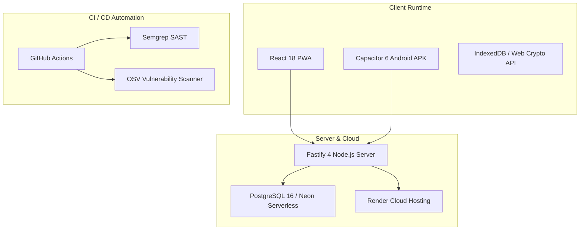
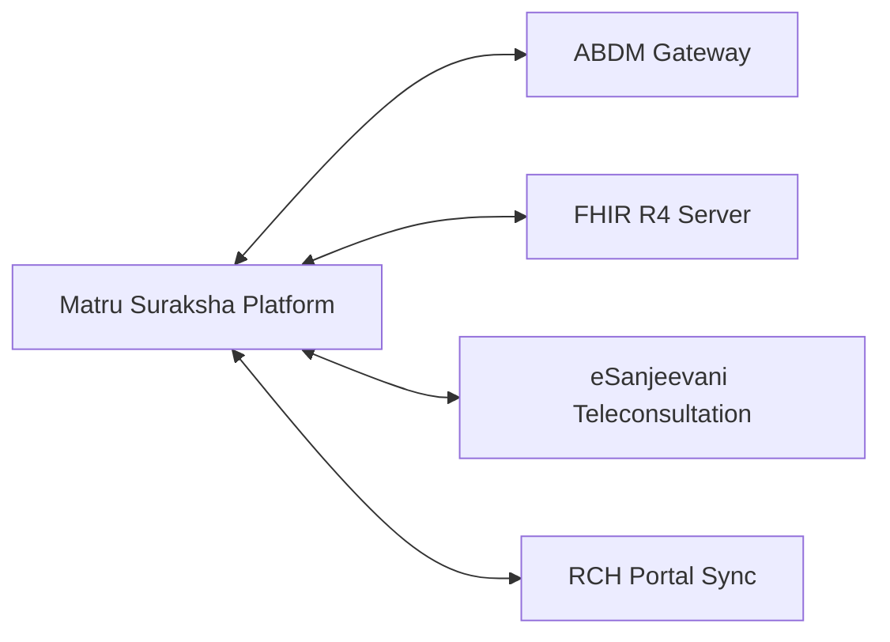

# Matru Suraksha — Integrations & Third-Party Services

This document details the existing infrastructure integrations, cloud services, and planned external health system interoperability points (ABDM, FHIR, eSanjeevani) for **Matru Suraksha**.

---

## 1. Existing Infrastructure & Platform Integrations

### 1.1 Client Runtime Integrations
- **Capacitor 6 (@capacitor/android, @capacitor/cli):**
  Packages the web application into an offline-first Android APK. Provides hardware integration, Webview isolation, and native bridge capabilities for frontline tablets.
- **Service Worker / Workbox:**
  Automates precaching of CSS, JavaScript bundles, SVGs, and web fonts (`vite-plugin-pwa`). Enables application startup without active cellular connectivity.
- **Web Crypto API:**
  Hardware-accelerated native browser cryptography (`SubtleCrypto`) providing PBKDF2 key derivation and AES-256-GCM authenticated encryption directly on Android devices.

### 1.2 Cloud & Database Infrastructure
- **PostgreSQL 16:**
  Primary transactional storage using Kysely for type-safe parameterized query execution.
- **Neon Serverless PostgreSQL:**
  Used for preview and staging environments with instant branching and connection pooling via PgBouncer.
- **Render (`render.yaml`):**
  Automates continuous deployment of the Node.js Fastify API server and static client assets from the `main` branch.

### 1.3 CI/CD & Security Tooling
- **GitHub Actions:**
  Orchestrates automated verification pipelines across pull requests and branch pushes (`.github/workflows/ci.yml`).
- **Semgrep Static Application Security Testing:**
  Scans TypeScript code against OWASP Top 10 rules.
- **OSV-Scanner:**
  Assesses dependencies against Google’s Open Source Vulnerability database.

---

## 2. Planned Public Health System Integrations (Phase 4 / v2)

Matru Suraksha is architected to integrate with India's national digital health infrastructure:

### 2.1 Ayushman Bharat Digital Mission (ABDM)
Compliance with the National Health Authority (NHA) digital health stack is structured across three milestones:

| ABDM Milestone | Capability | Integration Method | Matru Suraksha Readiness |
| :--- | :--- | :--- | :--- |
| **Milestone 1 (M1)** | ABHA Creation & Verification | REST API over TLS with ABDM Sandbox Gateway (`/v0.5/users/auth/init`). | Patient registration schema includes `abhaNumber` (14-digit) and `abhaAddress` fields. |
| **Milestone 2 (M2)** | Health Information Provider (HIP) | Consent Manager notification webhook, clinical bundle encryption, and record sharing. | Encrypted ANC visit records ready for bundle generation upon consent authorization. |
| **Milestone 3 (M3)** | Health Information User (HIU) | Requesting historical maternal health records from other health facilities across India. | Medical Officers can query prior obstetrical complications via ABDM consent flow. |

### 2.2 FHIR R4 Interoperability
To facilitate data exchange between district hospital EMRs and state health dashboards, internal domain models map directly to HL7 FHIR Release 4 resources:

- **`Patient` Resource:**
  - `id`: System UUID.
  - `identifier`: System-generated RCH/MCTS ID and ABHA number.
  - `telecom`: Contact phone number.
  - `address`: Village, Gram Panchayat, HSC, and District.
- **`Encounter` Resource:**
  - ANC visits mapped to ambulatory encounters with attending staff reference.
- **`Observation` Resources:**
  - Vitals: Systolic BP, Diastolic BP, Hemoglobin, Blood Sugar (code LOINC mappings).
  - Risk Flags: High-risk pregnancy clinical triggers mapped to SNOMED-CT codes (e.g., Severe Anemia: `SNOMED 76272004`).
- **`CarePlan` Resource:**
  - The 15-day follow-up cycle and scheduled PMSMA/Sadar Hospital referral pathways.

### 2.3 eSanjeevani Telemedicine Integration
Allows Community Health Officers (CHOs) at Ayushman Bharat Health & Wellness Centres (HWC-SC) to initiate teleconsultations with specialist Obstetricians at Sadar Hospital:
- **Trigger:** High-risk identification during ANC check (e.g. severe hypertension or malpresentation).
- **Payload:** Structured summary of the current visit, past obstetrical history, and vital trends sent via secure bridge.
- **Outcome:** Teleconsultation prescription and referral plan automatically written back to the patient's Matru Suraksha record.

### 2.4 RCH Portal (Reproductive and Child Health) Sync
- **Current Challenge:** ANMs in Bihar currently perform double entry: once on paper/maternal registers and once on state RCH tablets.
- **Integration Target:** Batch API / CSV sync bridge to push verified ANC encounters into the Ministry of Health & Family Welfare (MoHFW) RCH portal, eliminating duplicate data entry for frontline healthcare workers.

---

## 3. Third-Party Service Dependencies

| Service / Tool | Purpose | License | Dependency Location |
| :--- | :--- | :--- | :--- |
| **PostgreSQL** | Primary Database | PostgreSQL License | Runtime Infrastructure |
| **Fastify** | HTTP Web Framework | MIT | `packages/server` |
| **Kysely** | SQL Query Builder | MIT | `packages/server` |
| **React** | Web UI Library | MIT | `packages/client` |
| **TanStack Query**| Async Server State Management | MIT | `packages/client` |
| **Dexie.js** | IndexedDB Wrapper | Apache-2.0 | `packages/client` |
| **Capacitor** | Android Native Shell | MIT | Root & Mobile project |
| **Tailwind CSS** | Design System & Styling | MIT | `packages/client` |
| **Lucide Icons** | Accessible Iconography | ISC | `packages/client` |
| **Zod** | Schema Validation | MIT | `packages/shared` |
| **Biome** | Linter & Formatter | MIT / Apache-2.0 | Root Tooling |
| **Vitest** | Automated Test Runner | MIT | Root Tooling |
