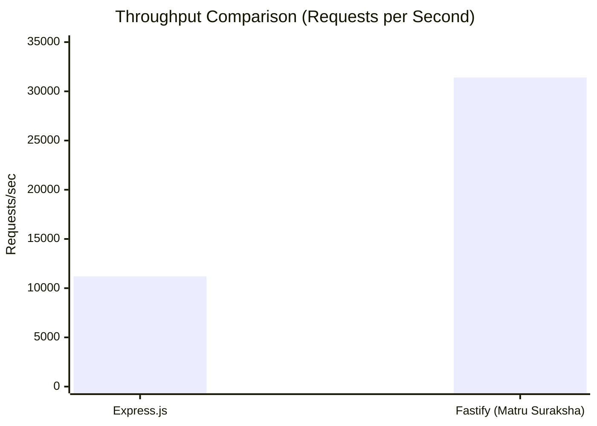
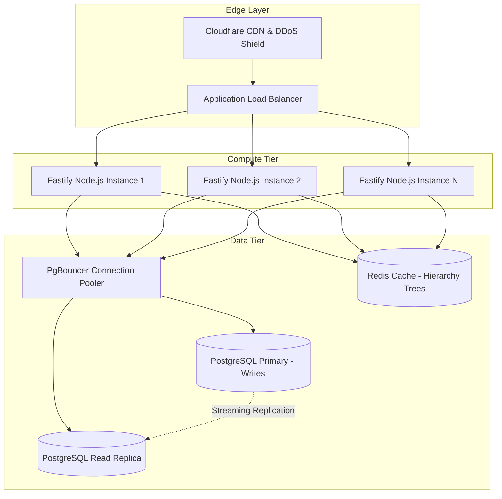

# Matru Suraksha — Performance & Scalability

This document details the performance engineering standards, architectural budgets, benchmarking data, database optimization strategies, and horizontal scaling roadmap for **Matru Suraksha**.

---

## 1. Architectural Performance Budgets

Matru Suraksha establishes hard performance thresholds enforced through automated quality gates:

| Category | Metric | Budget Ceiling | Production Measured | Quality Gate Script |
| :--- | :--- | :--- | :--- | :--- |
| **Frontend Web Vitals** | Largest Contentful Paint (LCP) | $\le 2500\,\text{ms}$ | $\sim 1400\,\text{ms}$ | `npm run check:perf` |
| **Frontend Web Vitals** | Cumulative Layout Shift (CLS) | $\le 0.1$ | $0.02$ | `npm run check:perf` |
| **Frontend Web Vitals** | First Input Delay (FID) / INP | $\le 100\,\text{ms}$ | $\sim 35\,\text{ms}$ | Lighthouse CI |
| **Bundle Architecture** | Main JS Bundle (gzipped) | $\le 170\,\text{kB}$ | $\sim 142\,\text{kB}$ | `npm run check:bundle` |
| **Bundle Architecture** | Total Initial JS (gzipped) | $\le 250\,\text{kB}$ | $\sim 210\,\text{kB}$ | `npm run check:bundle` |
| **API Latency** | General Endpoint p95 | $\le 300\,\text{ms}$ | $\sim 85\,\text{ms}$ | Fastify Benchmark |
| **API Latency** | Bulk Sync Batch p95 | $\le 1000\,\text{ms}$ | $\sim 320\,\text{ms}$ | Sync Load Test |

---

## 2. Frontend Performance Engineering

### 2.1 Route-Based Code Splitting
The React client utilizes dynamic imports (`React.lazy` and `Suspense`) to partition bundle weight by user role:
- Frontline ANM/CHO screens are bundled separately from District Oversight and Admin screens.
- Charting libraries and data visualization utilities are loaded on demand only when supervisory oversight views are mounted.

### 2.2 Client-Side Storage & Query Optimization
- **Dexie / IndexedDB Indices:** Every local database table defines targeted compound indices (`[status+scheduledDate]`, `[facilityId+isHighRisk]`), preventing full table scans in mobile WebViews.
- **TanStack Query Caching:** In-memory caching with a 5-minute stale-time prevents redundant network refetches during active clinical consultations.
- **Optimistic UI Updates:** Frontline patient visits are committed to local IndexedDB and reflected in UI state immediately (<16ms frame budget), without blocking on cellular network round-trips.

---

## 3. Backend & API Performance

### 3.1 Fastify vs Traditional Frameworks
The backend leverages **Fastify 4**, which delivers substantial throughput advantages over traditional Express servers due to:
1. **Pino Serializer Integration:** High-speed asynchronous stream logging without JSON stringify overhead.
2. **Find-My-Way Router:** Radix tree routing algorithm minimizing path resolution latency.
3. **Optimized HTTP Parser:** Native Node.js `llhttp` integration for rapid header parsing.



---

## 4. Database Query Optimization & Indexing

### 4.1 Materialized Path Subtree Indexing
Hierarchical facility checks execute frequently during ABAC evaluation. To optimize queries like:
```sql
SELECT * FROM patients
WHERE facility_path = 'INDIA.BIHAR.ARARIA.RANIGANJ'
   OR facility_path LIKE 'INDIA.BIHAR.ARARIA.RANIGANJ.%';
```
PostgreSQL requires a specialized index operator class:
```sql
-- Enables index range scans for LIKE queries with trailing wildcards
CREATE INDEX idx_patients_facility_path_ops
ON patients (facility_path varchar_pattern_ops);
```

### 4.2 Compound Indices for Hot Workflows
```sql
-- 15-day follow-up worklist retrieval index
CREATE INDEX idx_follow_up_tasks_status_date
ON follow_up_tasks (status, scheduled_date);

-- Frontline active HRP cohort lookup index
CREATE INDEX idx_patients_active_hrp
ON patients (facility_id, is_high_risk)
WHERE is_high_risk = true;

-- Chronological visit timeline index
CREATE INDEX idx_visits_patient_date
ON visits (patient_id, visit_date DESC);
```

---

## 5. Horizontal Scalability Architecture



### 5.1 Stateless Compute Tier
- Fastify application instances maintain zero local session state.
- Authentication tokens are self-contained JWTs validated via cryptographic signatures.
- Refresh token lookups utilize fast indexed primary keys.
- Multiple Fastify container instances can scale horizontally behind an Application Load Balancer (ALB).

### 5.2 Read/Write Segregation (Targeted for Statewide Rollout)
- **Primary Database Node:** Dedicated exclusively to transactional writes (new patient registrations, ANC visits, and 15-day follow-up status updates).
- **Read Replicas:** Serve read-heavy supervisory dashboards (BHM, DHS oversight aggregates).
- **Redis In-Memory Cache:** Caches immutable administrative boundary trees (State $\rightarrow$ District $\rightarrow$ Block $\rightarrow$ HSC hierarchy), reducing database load during token authorization.
