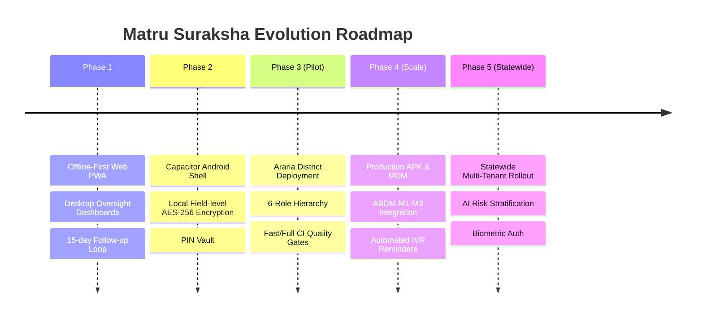

# Matru Suraksha — Future Improvements & Technical Roadmap

This document outlines the strategic engineering roadmap, architectural enhancements, and planned feature expansions for **Matru Suraksha** beyond the initial Araria district pilot.

---

## 1. Roadmap Overview

---

## 2. Priority Enhancements

### 2.1 Native Hardware Biometrics (WebAuthn / Android BiometricPrompt)
- **Current State:** Frontline tablets unlock local encrypted clinical storage using a 6-digit PIN and PBKDF2 key derivation.
- **Planned Enhancement:**
  - Integrate `@capacitor/biometrics` to support hardware fingerprint scanners on frontline Android tablets.
  - Wrap the existing in-memory DEK derivation with Android Keystore backed by hardware Secure Element (SE) / StrongBox.
  - Preserve 6-digit PIN as a secondary fallback.

### 2.2 Advanced Field-Level Three-Way Conflict Resolution UI
- **Current State:** The server applies a deterministic last-write-wins policy on patient demographic attributes during offline sync.
- **Planned Enhancement:**
  - Implement a visual conflict resolution modal in the client's "Sync Center".
  - If conflicting clinical observations occur during the same timestamp window (e.g. conflicting blood pressure readings from ANM and CHO), the interface presents a side-by-side diff allowing supervisory staff to select the authoritative record.

### 2.3 Automated Multi-Lingual IVR & SMS Outreach
- **Current State:** Follow-up contacts are logged manually by Block and District Helpdesk staff via telephone calls.
- **Planned Enhancement:**
  - Integrate an open-source IVR gateway (e.g. FreeSWITCH / Exotel API) to initiate automated voice reminders in local dialects (Hindi, Maithili, Bhojpuri, Surjapuri).
  - Remind mothers 48 hours prior to scheduled PMSMA sessions or referral visits at Sadar Hospital.
  - Automatically record outbound call outcomes directly into the `follow_up_tasks` table.

### 2.4 Ayushman Bharat Digital Mission (ABDM) Production Certification
- Complete formal sandbox testing with the National Health Authority (NHA).
- Issue verifiable ABHA cards during initial ANM community registration.
- Enable Health Information Exchange (HIE) across district borders for migrant workers returning to Araria.

### 2.5 Explainable AI Clinical Risk Stratification
- Assist frontline ANMs with early warning risk score computations based on historical obstetrical trends.
- Deliver plain-language explanations in the local vernacular to support patient counseling (e.g. explaining why hemoglobin < 7 g/dL requires urgent blood grouping and referral to Sadar Hospital).

---

## 3. Infrastructure & DevOps Upgrades

| Area | Current Implementation | Target Scaled Implementation |
| :--- | :--- | :--- |
| **Android Distribution** | Debug APK via GitHub Actions Artifacts | Production signed release APK distributed via State Mobile Device Management (MDM). |
| **Database Architecture**| Single PostgreSQL 16 instance with connection pool | Primary-Replica cluster with PgBouncer connection pooling and automated failover. |
| **Observability** | Pino JSON logs to stdout + Render console | Centralized OpenTelemetry collector forwarding to Prometheus & Grafana. |
| **Edge Caching** | Service Worker cache-first static shell | Global Edge CDN caching static assets and regional Cloudflare points of presence in India. |
