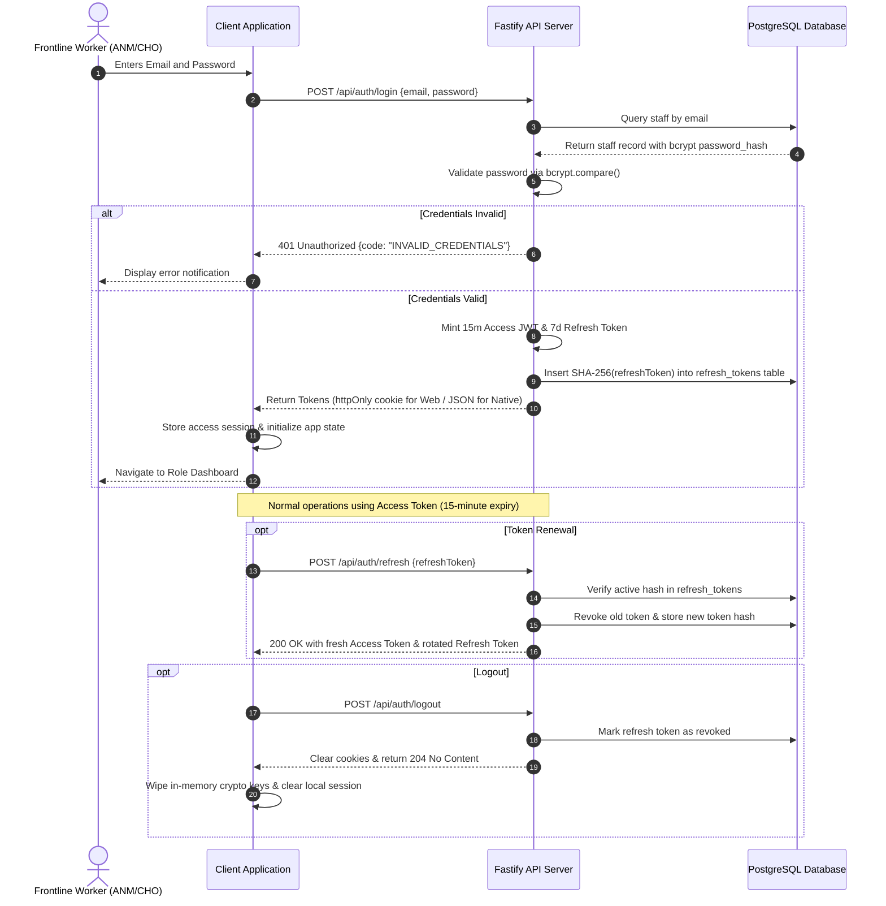
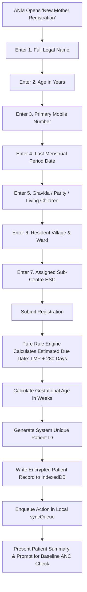
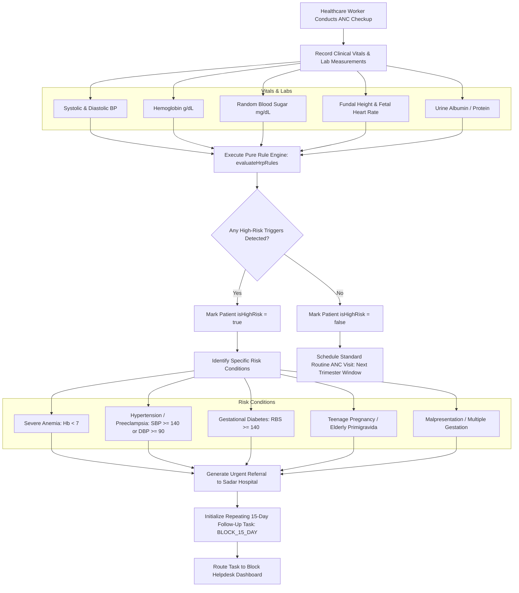
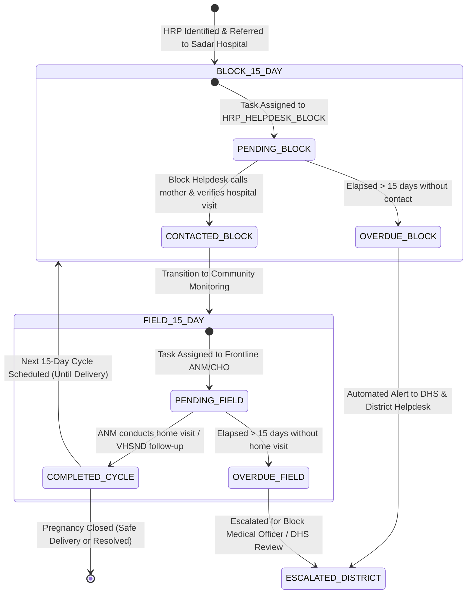

# Matru Suraksha — Application Flow Diagrams

This document contains visual workflow diagrams detailing the core clinical, administrative, and security processes in the **Matru Suraksha** platform.

---

## 1. Authentication & Dual-Transport Session Lifecycle



---

## 2. Frontline 7-Field High-Risk Intake Flow

Frontline ANMs register pregnant mothers using a streamlined 7-field intake flow optimized for high-volume rural outreach sessions:



---

## 3. Clinical ANC Check & High-Risk Trigger Flow



---

## 4. 15-Day Follow-Up State Machine



---

## 5. Device Registration, Pin Encryption, & Local Storage Unlock

```mermaid
sequenceDiagram
    autonumber
    actor Staff as Frontline ANM
    participant Tablet as Android Tablet / Client
    participant IDB as Local IndexedDB
    participant Server as Fastify API Server

    Note over Staff, Server: Initial Device Provisioning
    Staff->>Tablet: Installs APK & Enters Primary Server Credentials
    Tablet->>Server: POST /api/devices/register {fingerprint, model, osVersion}
    Server-->>Tablet: 201 Created {deviceId, status: "PENDING_APPROVAL"}
    Tablet-->>Staff: Screen displays "Device Pending Administrator Approval"

    Note over Server: District Admin approves device in Admin Dashboard
    Server->>Server: Update device status to "APPROVED"

    Staff->>Tablet: Launches App & Sets 6-Digit Secret PIN
    Tablet->>Tablet: Generate 16-byte random salt
    Tablet->>Tablet: PBKDF2(PIN, salt, 600,000 iterations) => AES-256 Key
    Tablet->>IDB: Store salt & PIN verification hash (never stores the PIN)
    Tablet->>Tablet: Retain AES-256 Key in volatile memory only

    Note over Tablet: Healthcare worker operates app with automatic encryption

    opt 5-Minute Inactivity or Manual App Lock
        Tablet->>Tablet: Clear in-memory CryptoKey reference
        Tablet-->>Staff: Displays "App Locked — Enter 6-Digit PIN"
    end

    opt Re-Unlocking
        Staff->>Tablet: Enters 6-Digit PIN
        Tablet->>Tablet: Derive key via PBKDF2 with stored salt
        Tablet->>Tablet: Verify against hash; restore CryptoKey in memory
        Tablet-->>Staff: Restores Clinical Dashboard
    end
```
