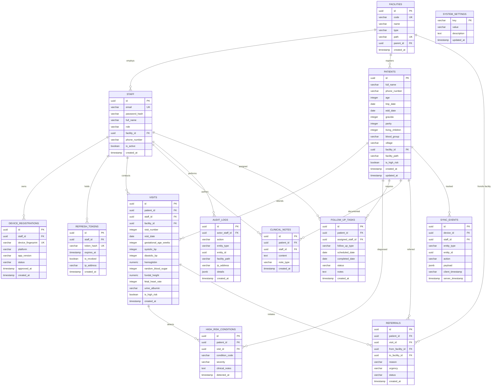

# Matru Suraksha — Database Entity-Relationship (ER) Diagram

This document provides a comprehensive Entity-Relationship diagram and relationship reference for the PostgreSQL 16 schema powering the **Matru Suraksha** platform.

---

## 1. Complete Entity-Relationship Diagram

---

## 2. Table Cardinality & Foreign Key Cascade Behaviors

| Parent Table | Child Table | Relationship | Foreign Key Column | On Delete Action |
| :--- | :--- | :--- | :--- | :--- |
| `facilities` | `staff` | 1 to Many | `staff.facility_id` | `RESTRICT` |
| `facilities` | `patients` | 1 to Many | `patients.facility_id` | `RESTRICT` |
| `facilities` | `facilities` | 1 to Many (Self) | `facilities.parent_id` | `RESTRICT` |
| `staff` | `device_registrations` | 1 to Many | `device_registrations.staff_id` | `CASCADE` |
| `staff` | `refresh_tokens` | 1 to Many | `refresh_tokens.staff_id` | `CASCADE` |
| `staff` | `visits` | 1 to Many | `visits.staff_id` | `RESTRICT` |
| `staff` | `follow_up_tasks` | 1 to Many | `follow_up_tasks.assigned_staff_id` | `SET NULL` |
| `patients` | `visits` | 1 to Many | `visits.patient_id` | `CASCADE` |
| `patients` | `high_risk_conditions` | 1 to Many | `high_risk_conditions.patient_id` | `CASCADE` |
| `patients` | `follow_up_tasks` | 1 to Many | `follow_up_tasks.patient_id` | `CASCADE` |
| `patients` | `clinical_notes` | 1 to Many | `clinical_notes.patient_id` | `CASCADE` |
| `patients` | `referrals` | 1 to Many | `referrals.patient_id` | `CASCADE` |
| `visits` | `high_risk_conditions` | 1 to Many | `high_risk_conditions.visit_id` | `SET NULL` |
| `visits` | `referrals` | 1 to Many | `referrals.visit_id` | `SET NULL` |

---

## 3. Storage & Partitioning Strategies (Planned Scaling)

1. **`audit_logs`:** High-volume immutable append-only log. Planned range partitioning by month (`created_at`) when transitioning from pilot (1 district) to statewide deployment (38 districts).
2. **`sync_events`:** Ephemeral synchronization audit log. Retained with a 90-day time-to-live (TTL) pruning job to maintain database performance.
3. **`visits` & `patients`:** Primary transactional tables indexed with compound B-Trees and `varchar_pattern_ops` for fast hierarchy traversal.
