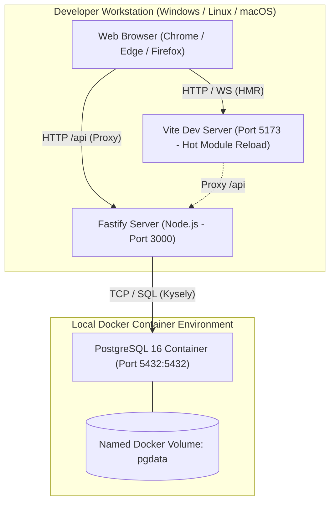
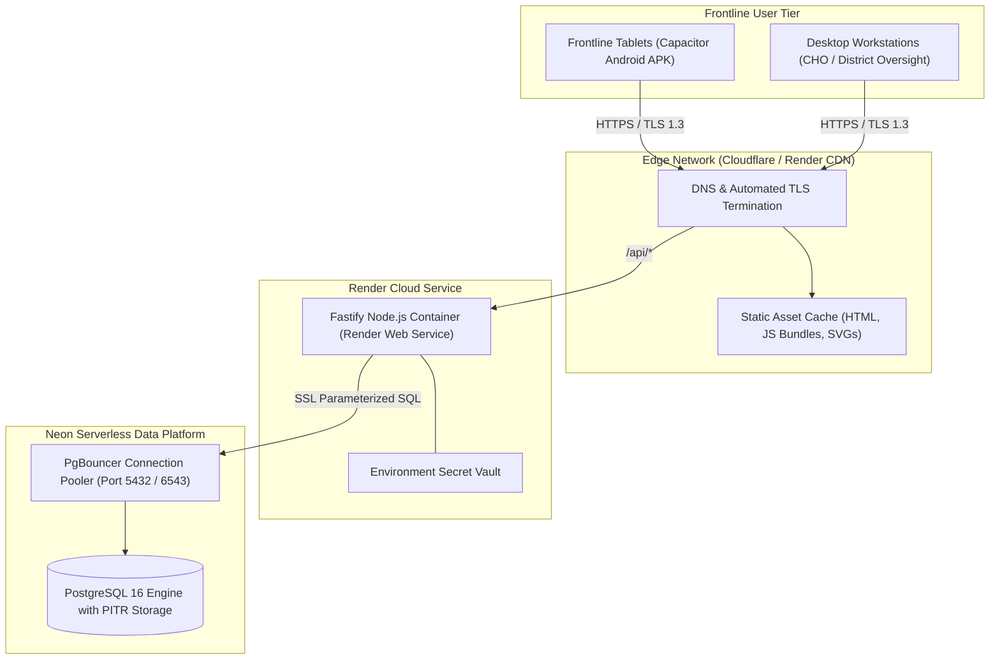
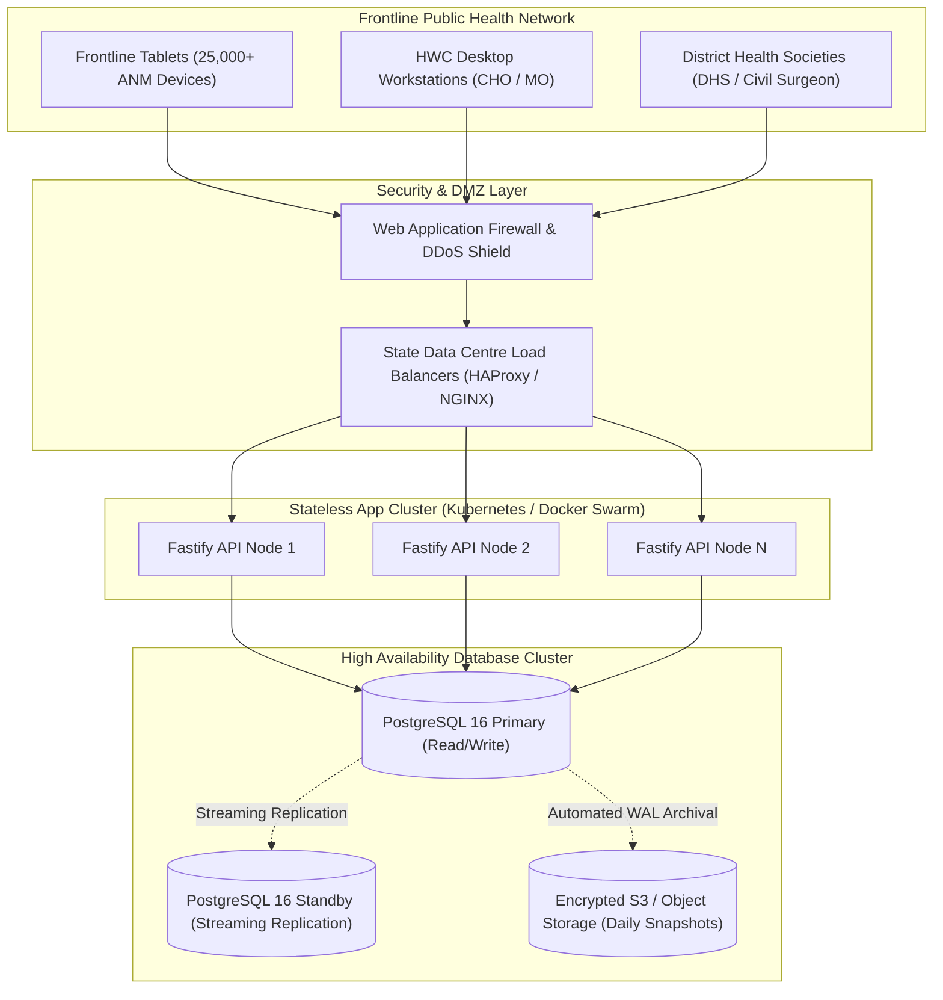

# Matru Suraksha — Deployment Architecture Diagrams

This document contains visual deployment topologies for local development, pilot cloud hosting, and sovereign statewide infrastructure configurations for the **Matru Suraksha** platform.

---

## 1. Local Development Topology (Docker & Vite HMR)



---

## 2. Live Cloud Pilot Topology (Render & Neon)

The live pilot demonstration deployment utilizes cloud infrastructure with continuous deployment:



---

## 3. Sovereign Statewide Deployment Topology (Target NIC / State Data Centre)

For full statewide rollouts across Bihar's 38 districts, the platform can be hosted within sovereign public cloud or State Data Centre (SDC) infrastructure:



---

## 4. Mobile APK Build & Distribution Pipeline

```mermaid
flowchart LR
    DevCommit[Code Push to main] --> GHAction[GitHub Actions CI Pipeline]
    GHAction --> BuildWeb[npm run build (Vite PWA Assets)]
    BuildWeb --> CapSync[npx cap sync android]
    CapSync --> Gradle[./gradlew assembleDebug]
    Gradle --> APK[android/app/build/outputs/apk/debug/app-debug.apk]
    APK --> ReleaseArtifact[Uploaded as Pipeline Build Artifact]
    ReleaseArtifact --> TabletDownload[District IT Installs on Tablets via MDM / USB]
```
