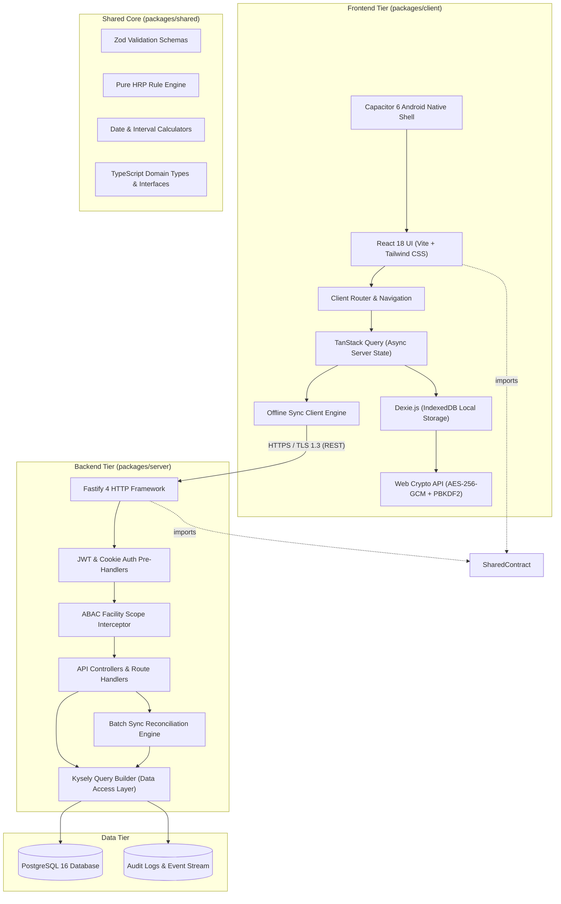
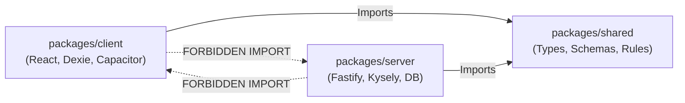
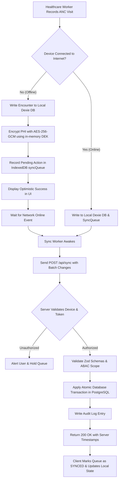

# Matru Suraksha — System Architecture Diagrams

This document contains visual architectural models illustrating the component hierarchy, package boundaries, offline-first data flows, and security zones of the **Matru Suraksha** platform.

---

## 1. High-Level Component & Package Architecture

---

## 2. Monorepo Boundary Constraints

Strict structural rules govern imports across workspaces:

- **Boundary Enforcement:** `packages/client` never imports from `packages/server`, and `packages/server` never imports from `packages/client`. All shared contracts reside strictly in `packages/shared`.

---

## 3. Data Synchronization Flow (Online vs Offline)

